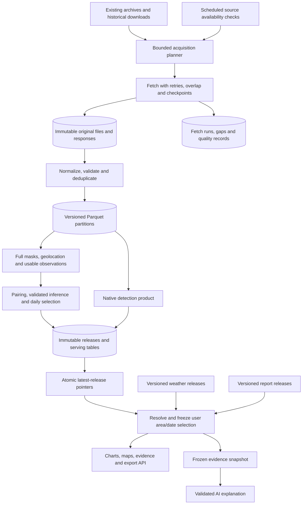
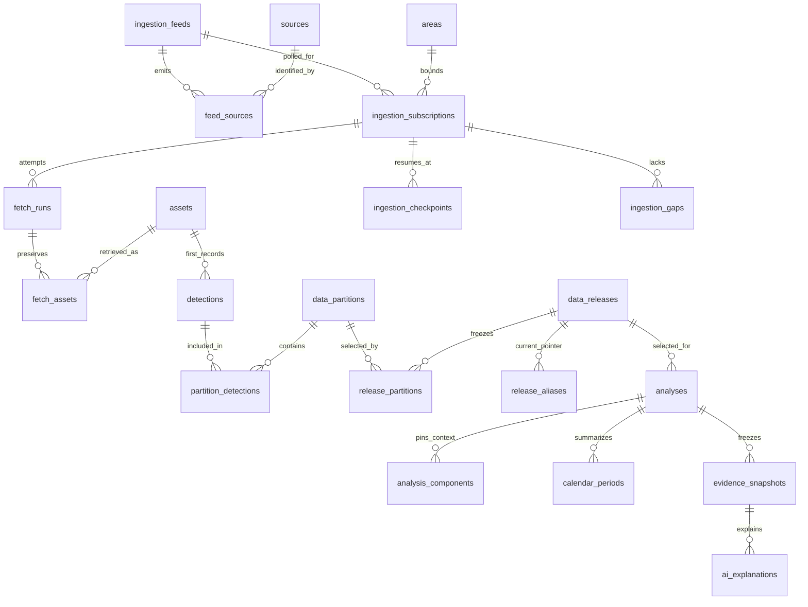
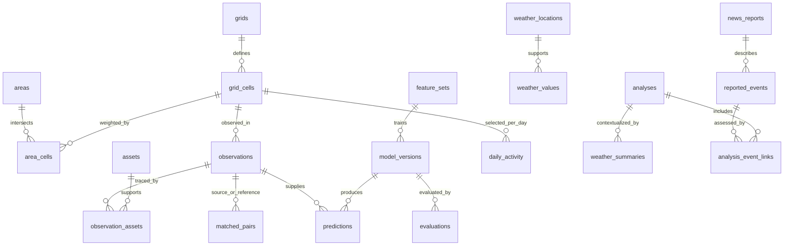

# FIREBRIDGE data platform: database, pipelines and API

> **Implementation update (October 26, 2026):** the data pipelines and database are now implemented in `src/firebridge`. The backend team will build the HTTP endpoints in **Node.js**. See [the current data guide](../data/README.md), [operations](../data/OPERATIONS.md) and [Node.js database handoff](../data/NODE_HANDOFF.md). The text below preserves the earlier design proposal; statements about FastAPI/Celery or an uninitialized database are superseded by that implementation guide.

**Version 2 — October 24, 2026. Proposed implementation specification.** No live database, scheduled ingestion or external subscription is created by this document.

The system will maintain two satellite views: a **standard historical record** for reproducible analysis, and a **recent provisional record** that can change as observations arrive or are reprocessed. Historical weather, recent model weather and dated reports are separate evidence streams. Every analysis pins exact versions so its charts, exports and AI explanation agree.

Read this overview first, then [all tables and columns](DATABASE.md), [pipeline procedures](PIPELINES.md), [endpoint contracts](API.md) and [verified source interfaces](SOURCES.md). The [SQL schema](schema.sql) defines the database. The [validation receipt](validation.json) describes what was checked.

**1. Full system picture**

“Recent” means the latest available satellite observations, with their acquisition time and latency shown. Polling more often cannot create additional overpasses or remove clouds. The app remains usable if a provider fails: the latest successfully published release stays available with a stale/partial status.

**2. What belongs in each store**

| Store | Responsibility | Read by |
|---|---|---|
| Original files/object storage | Original ZIP/CSV/HDF/netCDF/API responses, including empty successful responses; checksums and access-controlled paths | Ingestion, audit and scientific workers |
| Parquet/GeoParquet and raster artifacts | Large global records, feature rows, usable masks, immutable partitions, model artifacts | DuckDB/Python workers; bounded export jobs |
| PostgreSQL/PostGIS | Catalog, geographic objects, supported-region serving records, release membership, prepared analyses, jobs and evidence | FastAPI and workers |
| Redis | Queue transport and expendable cache | Celery workers/API |

PostgreSQL is the durable authority for jobs and release pointers; Redis loss must not erase the work ledger. The existing large global archives stay in the analytical store. The database contains complete serving slices for the supported scopes, not a random sample presented as all data. `data_partitions.serving_complete=false` makes the API use a queued lake query or report unsupported scope; it must not return a partial database count as the full count.

**3. Database design by responsibility**

The schema has 47 tables, including small join tables and operational ledgers. They form one database, not 47 services. Use foreign keys for relationships, unique constraints for identities, and versioned JSON only for product-specific metadata/contracts. All column types, required flags, units and constraints are listed in [DATABASE.md](DATABASE.md).

| Group | Tables | Why they exist |
|---|---|---|
| Source definitions | `sources`, `metric_definitions` | Exact product/stream definitions and explicit measurement units |
| Raw evidence | `assets`, `release_assets` | Immutable inputs and their release membership |
| Geographic support | `areas`, `grids`, `grid_cells`, `area_cells` | AOIs, fixed grid, land masks and AOI-intersection weights |
| Transport configuration | `ingestion_feeds`, `feed_sources`, `source_availability`, `ingestion_subscriptions` | Provider endpoints, normalized output sources, date availability and configured scopes |
| Execution and gaps | `fetch_runs`, `fetch_assets`, `ingestion_checkpoints`, `ingestion_gaps`, `pipeline_runs`, `quality_issues` | What was requested, what completed, what failed and where to resume |
| Canonical satellite records | `detections`, `observations`, `observation_assets`, `matched_pairs` | Native dots, usable opportunities and matched source/reference evidence |
| Model registry | `feature_sets`, `model_versions`, `evaluations`, `predictions` | Reproducible features, models, held-out evaluation and supported predictions |
| Published data | `data_partitions`, `partition_detections`, `partition_dependencies`, `release_partitions`, `data_releases`, `release_aliases`, `release_changes`, `daily_activity` | Immutable snapshots, reusable files, canonical membership, publication and revisions |
| Weather | `weather_locations`, `weather_values`, `weather_summaries` | Native spatial/temporal support and reproducible selected-area summaries |
| Reports | `news_reports`, `reported_events`, `analysis_event_links` | Documents, event claims, date/location precision and reviewed associations |
| Selected analysis | `analyses`, `analysis_components`, `calendar_periods` | Frozen selection, separate context releases and computed comparable results |
| AI evidence | `evidence_snapshots`, `ai_explanations` | Exact facts and validated explanation attempts |
| API work delivery | `api_jobs`, `outbox_events` | Durable requests, retries, exports and reliable queue dispatch |

`assets.source_id` identifies the physical input product. A monthly MODIS file can contain both satellites. `detections.source_id` identifies its normalized Terra or Aqua record. Consequently a detection's source need not equal the enclosing combined-file source; the adapter validates that mapping through the feed/product contract.

**4. Main relationships**

One analysis has exactly one satellite component matching `analyses.release_id`; it can additionally pin historical-weather, recent-weather and reports releases. Missing components get explicit rows with null release IDs. Exact context asset/record membership is frozen in those releases' partition manifests. Queries must filter to that membership, not read all weather/news rows currently in the database.

**5. Identities, duplicates and corrections**

| Identity | Definition and consequence |
|---|---|
| Raw input | Product + native file/request key + revision + SHA-256; preserve original bytes |
| Identical detection | Source + canonical native record hash, with a versioned hash contract; repeat polls reuse that record |
| Native pixel identity | Product/platform/granule/pixel where documented; use to detect revisions, never rounded latitude/longitude alone |
| CSV without stable pixel identity | Deduplicate exact canonical rows; handle changed rows by replacing the complete affected time/spatial partition, without guessing one-to-one event matches |
| Partition | Series + deterministic half-open time/spatial key + content hash; one immutable complete output snapshot |
| Release | Frozen mapping of every served series/partition key to one partition revision, plus code/config/input manifests |
| Current version | Mutable alias to a validated published release, changed atomically |
| Analysis | Exact geometry revision + dates/time basis + metric/filters + satellite/context releases + policies + requester visibility scope |

Partition snapshots contain the full canonical contents of their key, not just newly seen points. A corrected file can remove a detection; an append-only insert of new rows would miss that correction. Validate complete authoritative retrieval before interpreting disappearance as a withdrawal. A partial response, failed request or truncated news search cannot delete existing evidence.

For standard replacement, select one authoritative standard snapshot per product/time/shard when it is verified complete for that query scope. Preserve all prior NRT data in older releases. Replacement can add, remove or change records. Do not merge NRT and standard detections of the same platform into the same selected period and double-count them. The absence of a standard row is not itself proof that a particular NRT hotspot was false.

RT/URT rows require special handling: the FIRMS area page says they can expire after six hours or be replaced by NRT. The initial product accepts NRT/standard levels and retains RT/URT only in raw evidence; show them in a distinct later experimental layer if wanted. Their disappearance is not a scientific retraction. [FIRMS area documentation](https://firms.modaps.eosdis.nasa.gov/api/area/)

**6. Historical and recent release modes**

| Mode | Membership | Meaning |
|---|---|---|
| `standard_only` | Published standard observations available for the selected products and periods | Reproducible retrospective analysis; recent dates may be unavailable |
| `best_available` | Standard where verified available, otherwise NRT in explicitly marked partitions | Recent descriptive detections with per-period stream labels |
| `nrt_only` | Preserved NRT partitions from declared fetches | Inspect what the provisional stream contained; not automatic operational-time replay |

These are request selection policies. `data_releases.stream` stays `retrospective`, `provisional` or `experiment`; a mixed best-available release is provisional and preserves each partition's actual stream. The harmonized response is only produced for validated product/stream/regime combinations. An unvalidated NRT adapter can appear in native-dot views without contributing a harmonized estimate. Do not bridge a recent gap with a model trained only on standard data and assume equivalent behavior.

Each alias describes the declared inventory of its registered scope, including reused historical partitions and new recent partitions. A seven-day recent feed must not masquerade as a complete all-history release: missing historical keys stay explicit or are resolved from the parent standard inventory during publication. Query handlers never stitch arbitrary versions after the analysis has been created.

The first implementation keeps complete relational observation/pair/daily rows for each small supported release. Immutable Parquet partitions are shared when unchanged. This makes release-local foreign keys simple, but duplicates some serving rows between releases. Measure volume before expanding; a later normalized observation-version/membership schema can reduce duplication. Do not silently serve one release's mutable observations through another release ID.

**7. Publication and consistency**

Workers first write immutable files under temporary keys, validate them, then finalize checksum-addressed objects. Database publication is a short transaction:

1. Lock the relevant `(alias, scope_key)` or compare its generation with the planned parent.
2. Check accepted inputs, complete partition membership, scientific gates and all required serving rows. Blocking issues stop the publication; intentional gaps remain explicit.
3. Insert/finalize the new immutable release and full membership. Copy unchanged manifest pointers, not all original bytes.
4. Record `release_changes`, change the alias and insert an outbox `release.published` event in the same transaction.
5. Commit, then dispatch the outbox. A crash before commit leaves the old release visible. A crash after commit is recovered by retrying outbox delivery.

The outbox is delivered at least once. Consumers deduplicate with its event key and use idempotent job identities. A lease allows work to recover after worker death. A broker delivery receipt is not a successful pipeline result.

Resolve all requested aliases to fixed UUIDs at analysis creation in one consistent database transaction. Analysts see that snapshot until they explicitly choose “Refresh to latest.” A refresh creates a new analysis; old charts, exports and explanations stay reproducible. Changes invalidate “latest” lookup caches but never rewrite cached immutable results. Component refreshes create new evidence snapshots and AI cache keys.

When a repeated detection reuses its first-seen canonical row, retain both that row's original asset provenance and the current query's raw snapshot in the release input manifest. A countable record and a new sighting of the same record are different bookkeeping facts.

**8. Time, coverage and freshness contracts**

Record five different times where applicable: event/acquisition time, provider publication/update or model-issue time, fetch time, processing completion and release publication. A successful empty request updates `last_fetch_success` but leaves `latest_observation_at` null/unchanged. It is not evidence of clear no-fire coverage. A max-detection timestamp is not a safe ingestion cursor.

Freshness responses include `last_attempt_at`, `last_success_at`, `queried_through`, `latest_observation_at`, `published_at`, `next_check_at`, `availability_status` and `ingestion_gaps`. Separate `observation_coverage` from `ingestion_completeness`. Counts can be complete for a downloaded point feed while local cloud coverage is unknown.

Use half-open intervals internally. The existing MODIS EDA window is `[2024-01-17T00:00Z, 2025-01-18T00:00Z)` in UTC. The comparable cell-day calendar uses a versioned local-solar-day policy. Fetch enough boundary context for that policy; retain exact UTC acquisition timestamps. The API never silently changes the selected reporting basis. Weather intervals are aligned to the same chosen basis, with precipitation interval semantics preserved.

Database constraints enforce ordinary relationships, finite supported probabilities and basic eligibility. Publication checks enforce the scientific conditions that cross rows/files: compatible masks, disjoint area categories, shared support, frozen holdouts, model domain, canonical partition uniqueness, valid land weights and consistent denominators. See the dictionary's publication checklist.

**9. Capacity, indexing and retention**

Use the schema's GiST geometry indexes and B-tree source/time, partition, fetch and job indexes. Raw-date queries first select the release's partition IDs, then join canonical records and apply exact AOI/time predicates. Use `ST_Intersects`/`ST_Covers` with indexed WGS84 geometries; calculate areas in the grid's equal-area CRS. Avoid applying a transformation to every stored geometry in an indexed filter. [PostGIS index guidance](https://postgis.net/documentation/faq/spatial-indexes/)

Load small serving slices with staging tables and bulk COPY, validate counts and hashes, then publish. Start unpartitioned in PostgreSQL for the supported pilot. Large archive rows stay in date/source/shard-partitioned Parquet. If PostgreSQL partitioning is later needed, redesign keys and foreign keys to include partition keys before migrating; no claim is made that the present global identity keys can simply be attached to monthly partitions.

Retain raw scientific files and every artifact referenced by a published analysis/model. Identical payloads can share storage, but distinct revisions remain. Proposed operational retention: detailed redacted fetch logs 90 days, compact run/checkpoint/gap records longer, temporary failed files 7 days, exports 7 days. These are configurable engineering defaults, not provider requirements. Never delete referenced inputs during cleanup. Respect article/provider reuse terms; preserve citation metadata and permitted summaries instead of full news bodies by default.

**10. Implementation sequence**

1. Create catalog, geometry, raw assets, native detections and canonical release membership; import the already-validated MODIS data first.
2. Implement one bounded FIRMS subscription with exact-row deduplication, successful empty requests, checkpoints, gap repair and atomic publication.
3. Serve selected-area native maps/counts and source freshness. Add async analysis/export jobs and stable pagination.
4. Decode one real mask/geolocation window and establish valid positive/negative/missing opportunities; then implement matching, evaluation and the comparable calendar.
5. Add historical/recent weather and reviewed reports with separate pinned releases.
6. Add the AI explanation using only the selected evidence snapshot.
7. Exercise crash recovery, late arrivals, standard replacement, reprocessing and stale-provider behavior before enabling regular schedules.

Current acquisition scripts are useful input adapters, not a production scheduler. `analysis/acquire_modis_monthly.py` is pinned to January 2024–January 2025 and a bounded sample size. `analysis/download_science.py` selects sample companions and does not implement the complete inventory/coverage/revision process above. Preserve the EDA outputs as regression evidence while extracting reusable ingestion modules.
