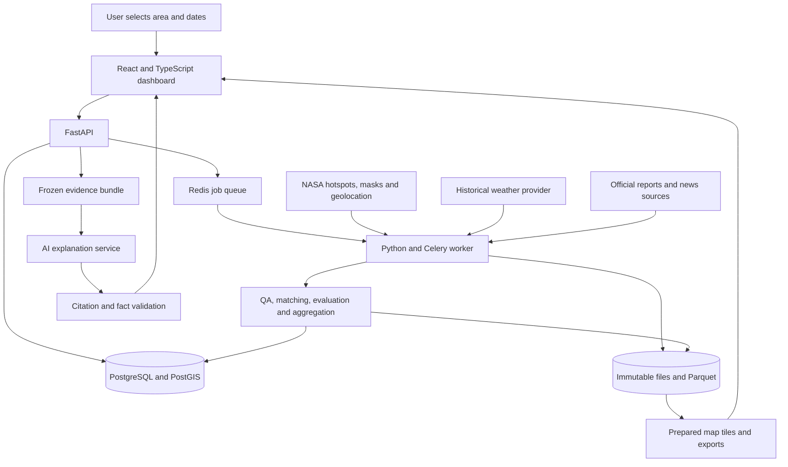
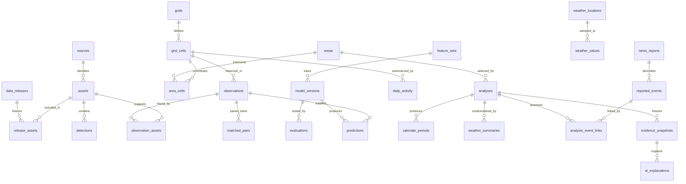
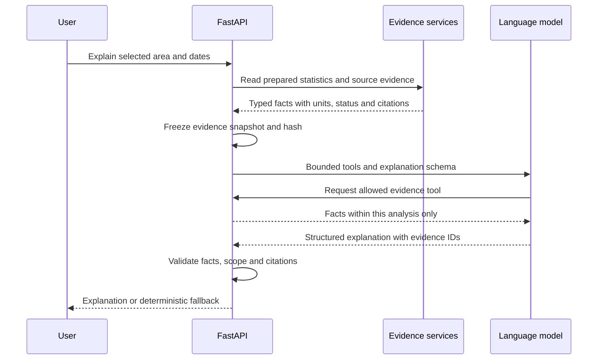

# FIREBRIDGE: system and database design

> **Implementation update (October 26, 2026):** the data pipelines and database are now implemented in `src/firebridge`. The backend team will build the HTTP endpoints in **Node.js**. See [the current data guide](../data/README.md), [operations](../data/OPERATIONS.md) and [Node.js database handoff](../data/NODE_HANDOFF.md). The text below preserves the earlier design proposal; statements about FastAPI/Celery or an uninitialized database are superseded by that implementation guide.

**Architecture overview, updated October 24, 2026. Status: proposed architecture, not a running application.**

**For the detailed data design, start with [DATA_PLATFORM.md](DATA_PLATFORM.md).** It extends this overview with historical imports, near-real-time refresh, correction handling and publication. Use [PIPELINES.md](PIPELINES.md) for each worker procedure and schedule, [API.md](API.md) for all 28 endpoint contracts, [DATABASE.md](DATABASE.md) for every table/column, and [SOURCES.md](SOURCES.md) for currently checked provider interfaces. Those version-2 contracts control where this earlier overview is less detailed.

FIREBRIDGE will let someone select a place and dates, explore satellite-observed burning, compare satellite records on a defined common scale, and read an evidence-linked explanation. Weather describes the conditions. Dated reports can corroborate an event when the location, event dates and source are sufficiently clear. The app keeps these different kinds of evidence visible.

This design extends the [project blueprint](../../FIREBRIDGE_Blueprint.md) with the requested database, web application, weather integration, news evidence and AI explainer. The [complete table and column dictionary](DATABASE.md) and [SQL schema](schema.sql) accompany it. The SQL is a design artifact for an empty development database; it has not been applied to your data.

**What already exists and what comes next**

The repository currently contains Python acquisition and EDA pipelines, Parquet datasets, reports and slides. The MODIS analysis covers January 17, 2024 through January 17, 2025, with 4,876,343 detections worldwide. It is evidence of working data preparation, not a finished harmonization model. See the [analysis summary](../../reports/modis_2024_2025/summary.json).

The existing mixed archives contain about 148 million raw rows across several products and periods. Keep those large files outside the application database and load only the supported region/time partitions into the serving layer. Full fire masks and compatible geolocation are still missing from the local science-file inventory. Until those are acquired and decoded, the app can show descriptive detections, but cannot treat an absent point as a valid negative or claim completed harmonization.

**1. The product the team will build**

The main journey is: **select area → select dates → inspect activity and coverage → compare sensors → inspect weather/reports → ask “Explain this selection.”**

| Screen or panel | What the user sees |
|---|---|
| Explore | Map, area selector, date range, source filters, hotspot layer and analysis grid |
| Activity calendar | Daily/weekly/monthly comparable response, observation coverage and unsupported periods |
| Satellite comparison | Source counts in one view; source responses and harmonized response in a separate common-unit view |
| Weather | Temperature, humidity, wind and precipitation over the same dates, with provider, spatial resolution and missing periods |
| Reports | Dated source links, event location/date uncertainty and whether the report is consistent with the selected observations |
| Explain selection | Plain-language summary, supporting evidence, limitations and suggested investigation |
| Evidence and methods | Input files, product versions, quality exclusions, model evaluation and export |

Weather and report panels may be unavailable while satellite results remain usable. A failed news search must never turn into “no fire occurred.” A source count is always labelled **detections**, because several points can belong to one incident.

**2. Recommended languages and frameworks**

These are engineering choices for this team, not NASA requirements. Pin exact compatible versions in lockfiles when implementing.

| Layer | Choice | Why it fits |
|---|---|---|
| Frontend language | TypeScript | Typed API responses and clearer component contracts |
| Web framework/build | React + Vite | A focused client dashboard; Python already owns the data/API work |
| Styling | Tailwind CSS + accessible components | Consistent panels, controls and responsive layouts |
| Map | MapLibre GL JS + Terra Draw integration | Map layers and drawn polygons; verify drawing integration during the UI spike |
| Charts | Apache ECharts | Calendar heatmap, time series, source comparison and coverage views |
| Client data/state | TanStack Query + React Router | Query caching, loading/error states and shareable selection routes |
| Backend language | Python 3.12 initially | Reuse the working project environment and analysis code |
| API | FastAPI + Pydantic | Typed request/response validation and generated API documentation |
| Database access | SQLAlchemy + GeoAlchemy2; Alembic migrations | Typed relational/spatial access and explicit schema changes |
| Main database | PostgreSQL + PostGIS | Relationships, geographic filtering, AOI intersections and indexed map queries |
| Large data | Parquet/GeoParquet + DuckDB | Stream and aggregate global tables without loading everything into RAM or the web database |
| Satellite raster files | Original HDF/netCDF; derived COG or Zarr where appropriate | Retain original scientific files and explicit QA/geolocation lineage |
| Geographic processing | GeoPandas, Shapely, PyProj, Rasterio/GDAL | Projection, clipping and pixel/area calculations |
| Product decoding | Product-specific readers, including HDF4 support where required | MODIS and VIIRS formats cannot all be assumed readable with one generic loader |
| Harmonization | scikit-learn | Common-grid baseline, logistic calibration, then a more complex candidate only if evaluation supports it |
| Background work | Celery + Redis | A worker handles downloads, processing and cached analyses outside API requests |
| AI explainer | Official OpenAI Python SDK + Responses API | A bounded tool workflow and structured explanation output |
| Packaging | Docker Compose; Caddy reverse proxy | One understandable deployment on one host |
| Checks | pytest, database integration checks, Playwright | Scientific invariants, API behavior and the complete user journey |

MapLibre supports interactive vector-tile maps. Spatial queries should use PostGIS indexes and index-aware predicates. FastAPI's documentation recommends a separate queue system for heavier background computation. These support the proposed split between fast requests and workers. [MapLibre](https://maplibre.org/maplibre-gl-js/docs/) · [PostGIS](https://postgis.net/documentation/faq/spatial-indexes/) · [FastAPI](https://fastapi.tiangolo.com/tutorial/background-tasks/)

Start with one backend codebase, run as an API process and a worker process. A shared mounted data directory is enough locally; the same storage interface can later use an S3-compatible object store. The first cached demo can precompute all analyses and postpone Redis/Celery until asynchronous requests are needed. No separate vector database is required for structured satellite and weather results; PostgreSQL text search plus curated documents is enough initially.

**3. How the parts connect**



The backend calculates every statistic. The AI reads those results and explains them. It does not derive fire counts from prose, run arbitrary SQL or alter the harmonized calendar.

**4. Storage architecture and database relationships**

Use three storage roles:

| Storage | Contents | Example |
|---|---|---|
| Immutable files | Original files/API responses, checksums and source metadata | A MODIS monthly file, a fire-mask granule, a weather response |
| Analytical files | Large normalized tables, features, masks and frozen evaluation splits | Partitioned detections and observation features in Parquet |
| PostgreSQL/PostGIS | Product catalog, bounded serving rows, AOIs, prepared calendars, evidence and job state | A selected Morocco week and the evidence behind it |

The expanded schema has **47 tables**, including operational ledgers and small join tables. The table below summarizes the original scientific/application core; [the data-platform overview](DATA_PLATFORM.md) includes the ingestion, revision, publication and job tables. Implement these in stages. `PK` means unique row identifier; `FK` means a link to another table. The dictionary lists every column, type, default, key and constraint.

| Group | Tables | Purpose |
|---|---|---|
| Sources and reproducibility | `sources`, `assets`, `data_releases`, `release_assets`, `pipeline_runs` | Know exactly where data came from and which processing produced a result |
| Geography | `areas`, `grids`, `grid_cells`, `area_cells` | Save AOIs, analysis cells and land-area weights |
| Satellite evidence | `detections`, `observations`, `observation_assets`, `matched_pairs` | Separate detections, observation opportunities and comparable pairs |
| Model and daily product | `feature_sets`, `model_versions`, `evaluations`, `predictions`, `daily_activity` | Reproduce training, evaluate it, and select one supported daily response |
| User analysis | `analyses`, `calendar_periods` | Freeze the user's selection and serve its calendar |
| Weather | `weather_locations`, `weather_values`, `weather_summaries` | Retain native weather support and derive AOI context |
| Reports | `news_reports`, `reported_events`, `analysis_event_links` | Separate documents, reported events and assessed matches |
| AI evidence | `evidence_snapshots`, `ai_explanations` | Save the exact facts used by each explanation |



The diagram shows major links; SQL contains the complete foreign keys. `matched_pairs` references `observations` twice: source and Aqua reference, within the same cell and release.

**5. Scientific rules encoded by this design**

| Rule | Implementation consequence |
|---|---|
| A hotspot is not an incident | No `fires` table inferred directly from point rows; reported events remain attributed claims |
| No dot is not a valid negative | `observations` contains masks, usable support and explicit eligibility; missing values stay null |
| Products are not interchangeable | `sources` identifies platform, instrument, collection, stream and schema version |
| Confidence fields have different meanings | Keep native confidence and its scheme; do not create a common probability from MODIS/VIIRS confidence |
| Native brightness bands differ | `brightness_bands` records band name, value and unit, not an unexplained generic temperature |
| Scan/track values differ by product | Populate `scan_km`/`track_km` only when documentation defines those units; keep Landsat native fields separately |
| Extra satellites must not inflate activity | `daily_activity` selects at most one opportunity per cell/day/metric using a fixed policy |
| Results must be reproducible | Freeze source assets, QA policy, grid, model, selection rules and release |
| Provisional data can change | NRT and standard data have separate sources/releases; replacement creates a new release |
| Valid geography matters | Use reviewed AOI/land geometry and area calculations in the grid's equal-area projection |

Start with the blueprint's 5 km Morocco grid and Aqua–S-NPP afternoon pairing. Treat 30-minute matching and 80% shared usable land as hypotheses to evaluate. Terra requires separate treatment of observation time. NOAA-20 and NOAA-21 each require their own product checks and validation. Landsat imagery, when acquired, can provide supporting spatial context; the current Landsat hotspot files are not before/after images or burned-area labels.

For each eligible cell-day, use an observed Aqua indicator or one supported model estimate. The calendar response is `sum(AOI cell land area × response) / sum(eligible AOI cell land area)`, summed across selected days. Coverage is eligible land-area-days divided by possible land-area-days. `calendar_periods` stores those numerators and denominators so null denominators cannot silently become zero activity. The response describes reference-equivalent active-cell observations; it is not hectares burned or the probability that a real fire exists.

Daily selection uses approximate local solar date per cell, with a versioned conversion. Raw timestamps stay UTC. The interface clearly labels the selected time basis; Africa/Casablanca is for civil-time display. Weather summaries must use the same reporting intervals, including boundaries, or visibly state a different time basis. The MODIS EDA's original UTC date selection remains unchanged.

For drawn boundaries, the metric uses land-area weights for intersecting analysis cells. It remains a cell-scale response, so activity somewhere inside a boundary cell can contribute to the AOI score. Show that spatial limitation; do not label a tiny polygon as precisely resolved. Unsupported grid extents and overly small AOIs receive a clear scope message.

**6. Data pipeline**

1. **Inventory:** discover products and matching companions; create source records and file manifests before downloading. Resolve compatible product collections explicitly.
2. **Acquire:** retain original bytes, verify hashes, record retrieval times and quarantine invalid inputs. API credentials remain server-side.
3. **Normalize points:** parse UTC times, preserve native fields and deduplicate source identities. Choose a canonical representation when FIRMS and a science swath describe the same detection; use the other as corroborating input, not an additional observation.
4. **Build opportunities:** decode complete masks/QA and geolocation, union overlapping footprints within a pass, and calculate usable/cloud/invalid/unobserved land. Retain the actual usable geometry or mask, not just a percentage.
5. **Match:** pair source and reference independently of detected fire, intersect usable support, calculate features and labels on that intersection, and freeze splits.
6. **Evaluate:** compare the common-grid baseline, logistic calibration and any justified candidate on blocked temporal/geographic holdouts. Store sample, positive and independent-block counts alongside metrics.
7. **Publish daily product:** require validated source/model support, select one eligible pass using a fixed policy, and emit explicit missing/unsupported cell-days too.
8. **Add context:** collect historical weather and relevant dated reports, calculate reproducible weather summaries, and review report matches.
9. **Serve and explain:** prepare calendar/map outputs, freeze an evidence bundle and generate a validated explanation.

There is no training job on every user click. A click reads a published release or queues a bounded aggregation. Expensive ingestion and model training happen before publication. Existing `analysis/` scripts should be extracted into reusable modules gradually, with their outputs checked against the completed EDA.

**7. Weather integration**

**First implementation:** use Open-Meteo's Historical Weather API with the model explicitly fixed to **ERA5**, for a consistent set of temperature, humidity, precipitation and wind variables. Avoid silently changing models with the default “Best Match.” Cache requested coordinates, returned coordinates/elevation, raw response, provider units and retrieval date. Variable availability differs by model. [Open-Meteo historical API](https://open-meteo.com/en/docs/historical-weather-api)

**Research extension:** use Copernicus CDS ERA5/ERA5-Land gridded files directly where area-wide weighting or soil moisture is needed. ERA5-Land has approximately 9 km native resolution and a 0.1° distributed grid; it is a historical reanalysis with uncertainty. Resampling it onto a 5 km fire grid does not add independent weather detail. [Copernicus ERA5-Land](https://cds.climate.copernicus.eu/datasets/reanalysis-era5-land?tab=overview)

| Variable | Normalized storage | Useful explanation |
|---|---|---|
| Air temperature at 2 m | °C, hourly instant or defined interval statistic | Conditions during the selected period |
| Relative humidity at 2 m | %, hourly | Moisture conditions; retain derivation if calculated from dew point |
| Wind at 10 m | m/s; u/v components or direction in degrees | Wind conditions; vector-aware direction aggregation |
| Precipitation | mm over an explicit interval | Rainfall during and before the period |
| Soil moisture, later | m³/m³ with layer depth and source | Longer moisture context |
| Cloud cover, optional | % with weather-source definition | Atmospheric context; never a substitute for satellite fire-product QA |

For an AOI, intersect native grid footprints with the land polygon and compute area-weighted statistics. If the API only provides point samples, label them **sampled weather context**, retain the sampling method and do not claim an exact area average. Deduplicate samples that map to the same weather cell. Store weights and input IDs in manifests. Do not fetch just the AOI centre and describe it as weather everywhere in a large region.

Daily rainfall is the sum of decoded interval amounts at each location, then an area-weighted mean depth across the AOI; do not sum rain depths across locations. CDS accumulated fields require product-specific de-accumulation. Handle partial days, provider missing values, units, wind vectors and daylight-saving changes explicitly. The initial solar-day product needs per-cell interval alignment before regional aggregation.

Show retrospective weather separately from forecasts. A forecast must preserve issue time, valid time and source model. “Weather available at the time” analyses also need availability timestamps; later reanalysis must not leak into a historical real-time simulation. Start with weather as explanatory context, outside the harmonization model.

Weather can support wording such as “the period was dry according to the selected reanalysis.” It cannot establish that a hotspot was a wildfire or that weather caused a particular ignition. “Hotter than usual” requires a defined multi-year, seasonally comparable baseline, not just this one annual cycle.

Open-Meteo currently distinguishes free non-commercial API access from other uses; preserve attribution and check the applicable quota/licence before deployment. [Provider terms](https://open-meteo.com/en/terms)

**8. News and official incident evidence**

For the 2024–2025 pilot, start with a small reviewed collection of official incident bulletins and original local reporting, discovered through date-aware search or publisher archives. Record the source URL, title, publisher, publication time, retrieval time, event dates, location precision and original reporting lineage. Keep a short permitted excerpt or your own summary; do not republish entire articles by default.

GDELT is an optional discovery adapter. Its DOC API documentation describes a rolling search window, while its downloadable datasets offer a different historical access route. The old documentation does not establish today's complete search coverage. Verify the actual endpoint limits before implementation and do not promise arbitrary 2024 search through a recent-news endpoint. [GDELT DOC documentation](https://blog.gdeltproject.org/gdelt-doc-2-0-api-debuts/) · [Historical data access](https://gdeltproject.org/data.html)

The matching pipeline extracts candidate event dates and place names, geocodes them with uncertainty, then compares the event interval and geographic support with the selection. A province-level report stays province-level; its centroid is not an exact ignition point. Publication date and event date remain separate. An article reporting fire risk or recalling an older fire must not be treated as a new observed incident.

Use these user-facing states: **candidate**, **consistent**, **conflicting**, **unresolved** or **rejected**. A reviewed field/official report may independently corroborate a reported event. An article that simply republishes FIRMS dots is dependent evidence. Several syndicated copies of one story count as one reporting lineage, not independent confirmations. Missing reports do not imply no fire. News matching must not change the satellite model's training labels automatically.

**9. AI agent architecture**

Build one bounded explanation agent with read-only tools. The backend binds the area, dates and release to a stored `analysis_id`, so the model cannot silently answer for another selection.

All tool responses for one explanation come from the same frozen snapshot, including the exact report revisions. A later weather refresh or report correction creates a new snapshot and cache key. The assistant may explain why evidence conflicts; it must not silently replace one version while answering.



| Read-only tool | Returns |
|---|---|
| `get_activity_summary(analysis_id)` | Metric definition, period values, native source counts and denominators |
| `get_observation_quality(analysis_id)` | Coverage, missing intervals, exclusions and model support |
| `get_sensor_comparison(analysis_id)` | Compatible source responses, model versions and evaluation evidence |
| `get_weather_context(analysis_id)` | Prepared statistics, units, time/spatial support and missingness |
| `get_report_evidence(analysis_id)` | Reviewed/candidate reports, event dates, uncertainty and source lineage |
| `get_method_definition(metric_key)` | Curated definitions and documented limitations |

Use strict function schemas and structured output through the Responses API. Keep the SDK/model choice configurable and record the actual model identifier and prompt version with each explanation. Schema adherence helps validation but does not establish factual correctness. [Official function-calling documentation](https://developers.openai.com/api/docs/guides/function-calling) · [Structured outputs](https://developers.openai.com/api/docs/guides/structured-outputs)

Suggested output fields are `summary`, `satellite_findings[]`, `coverage_findings[]`, `weather_context[]`, `report_evidence[]`, `limitations[]`, and `suggested_checks[]`. Each finding carries `evidence_ids[]` and a `claim_kind` such as `measured`, `model_estimate`, `reported` or `interpretation`. Numeric facts should reference typed fact IDs; the application can render the numbers and units deterministically. Citation URLs come from the evidence service, never from invented model links.

Before showing an answer, check that cited IDs exist, dates/area/release match, numbers and units match approved facts, coverage limitations are included, and “unusual” has a supported historical baseline. Reject claims that convert hotspot counts into incidents/hectares or turn weather/news into automatic ground truth. If generation fails, use a plain template populated from the same facts. If there is no eligible satellite evidence, say so explicitly and still show available context.

Use the provider key only on the backend. Give tools parameterized queries through a read-only database role, no shell and no arbitrary SQL or URL fetching. Treat article text as untrusted source content. Allowlisted retrieval adapters enforce URL/redirect checks, content size limits and timeouts. Cap tool rounds, output length, concurrent calls and daily spending; cache by snapshot hash, language, normalized question, prompt and model version. These controls keep the explainer predictable and affordable.

Evaluation should include missing data, cloudy periods, conflicting reports, an article mentioning a different year, a report copied from satellite data, unsupported NOAA-21 calibration and no historical baseline. Check factual agreement, citation validity, correct uncertainty and usefulness in English/French; add reviewed Arabic and RTL support if the team has capacity. The explainer and the scientific harmonization model are two separate components with separate evaluations.

**10. API contracts**

| Endpoint | Purpose |
|---|---|
| `GET /api/v1/catalog` | Available products, releases, date bounds, geography and supported methods |
| `POST /api/v1/areas` | Validate a polygon and create an immutable AOI revision |
| `POST /api/v1/analyses` | Submit a bounded area/date/metric/context request; return cached result or `202` with analysis ID |
| `GET /api/v1/analyses/{id}` | Status, supported scope, warnings and result links |
| `GET /api/v1/analyses/{id}/calendar` | Calendar values, numerator, denominator and coverage |
| `GET /api/v1/analyses/{id}/comparison` | Common-unit sensor/model comparison |
| `GET /api/v1/analyses/{id}/weather` | Context and its spatial/temporal support |
| `GET /api/v1/analyses/{id}/reports` | Dated evidence with match/review status |
| `GET /api/v1/analyses/{id}/cells/{cell_id}` | Passes, source files, QA, selection and model evidence |
| `GET /api/v1/analyses/{id}/tiles/{layer}/{z}/{x}/{y}.mvt` | Prepared/bounded map features |
| `POST /api/v1/analyses/{id}/explanations` | Generate or reuse a language-specific explanation |
| `GET /api/v1/explanations/{id}` | Explanation status, structured content and citations |
| `POST /api/v1/analyses/{id}/exports` | Queue bounded CSV/GeoJSON/Parquet plus methods and provenance |
| `GET /api/v1/jobs/{id}/download` | Retrieve an authorized prepared export |

The client date picker uses inclusive dates; the API converts them to an explicit exclusive end. For January 17, 2024–January 17, 2025, the stored date interval is `[2024-01-17, 2025-01-18)`, in the declared reporting time basis. Weather instants/intervals remain UTC and are aligned by the aggregation policy.

Every result envelope includes `analysis_id`, `data_release_id`, `metric_key`, units, time basis, grid version, selection policy, model versions, coverage, status and reasons. Source detection counts have their own units and scope. Null is used for unavailable calculations, never a made-up zero. Reject invalid or oversized polygons and dates outside available data. A valid request outside the scientific support domain returns an explicit unsupported result. Use cursor pagination and tiles for detailed points; do not transmit millions of rows to the browser.

**11. Deployment, access and performance**

One host can run `web/proxy`, `api`, `worker`, `postgres` and `redis`, with persistent database and file volumes. The proxy exposes HTTPS and the API; PostgreSQL and Redis stay on the internal network. Frontend configuration contains no secrets. Initially expose a read-only prepared demo; protect ingestion, publication, model administration and costly AI requests with an admin/session mechanism. User accounts, organizations and billing tables are outside the initial schema.

Use separate migration, ingestion and API database roles. The API should read published scientific results and write only bounded analysis/explanation requests through controlled services. Migrations are an explicit operation. Back up PostgreSQL and the referenced immutable files together; a database backup alone cannot recover model or mask artifacts. Record stage failures, timings and source availability without logging credentials or complete confidential prompts.

Add GiST geometry indexes and source/time indexes as shown in SQL. Start with bounded unpartitioned serving tables. If volume requires monthly partitioning later, redesign primary/foreign keys to include the partition key before migrating; do not add partitions while assuming the current single-column keys still enforce global uniqueness. Keep global archive analytics in partitioned Parquet. Materialize common pilot calendars and cache analyses by their full immutable configuration.

**12. Suggested repository layout**

```text
FIREBRIDGE-project/
  apps/web/                 React, TypeScript, maps, charts and explanation panel
  services/api/             FastAPI routes, typed contracts and authorization
  services/worker/          Celery entry points, retries and task status
  packages/firebridge/
    catalog/                Sources, manifests and immutable storage
    ingest/                 Product-specific satellite/weather/report adapters
    science/                QA, masks, geolocation, matching and features
    models/                 Training, calibration, support checks and evaluation
    calendar/               Daily selection, AOI weights and aggregation
    context/                Weather aggregation and report matching
    explainer/              Tools, evidence snapshots, prompts and validation
  db/migrations/            Alembic migrations created from the reviewed design
  tests/                    Small real fixtures and meaningful invariants
  infra/                    Dockerfiles and Compose configuration
  docs/architecture/        This design, dictionary, proposed SQL and validation
  analysis/                 Existing EDA scripts retained as references
  notebooks/                Existing exploration notebooks
  reports/                  Existing analyses and presentations
  data/                     Local immutable/raw and prepared artifacts
```

Only `docs/architecture/` and the README link are added for this architecture request; the app directories above are proposed.

**13. Build order and completion gates**

| Stage | Deliverable | Exit condition |
|---|---|---|
| 1. Data contract | Source catalog, manifests, AOI/grid and canonical point adapters | One displayed point traces to an input record; repeated ingestion does not duplicate it |
| 2. Descriptive app | Map, source calendar, date selection and provenance | A user can explore real data; unavailable coverage is clearly labelled |
| 3. Scientific foundation | Real mask/geolocation pairs and usable negative opportunities | One cell/pass has auditable positive/negative/missing semantics |
| 4. Harmonization | Baseline, blocked evaluation and daily selection | Hide/reveal Aqua test reports agreement, failures and supported scope |
| 5. Context | Cached historical weather and reviewed dated reports | Same area/dates, correct units, uncertainty and no false automatic confirmation |
| 6. AI explanation | Evidence tools, structured answer and validators | Every quantitative claim links to a checked fact; fallbacks pass evaluation |
| 7. Submission demo | Cached full journey, methods, evidence export and presentation | Runs without live data downloads; claims agree with measured evaluation |

For four teammates: one owns acquisition/QA, one harmonization/evaluation, one the map/frontend, and one API/context/explainer integration. Agree the API contracts and evidence IDs first. If scientific support is not achieved, present the descriptive application honestly and identify harmonization as incomplete. Weather/news/AI should make the evidence easier to understand, while the core submission remains a transparent, tested comparison of satellite fire records.

**The first concrete task is to obtain and decode a small Aqua–VIIRS set of fire masks and compatible geolocation, then produce traceable positive, valid-negative and missing observations.** In parallel, the frontend can use the existing prepared detections and clearly labelled descriptive summaries.

**Design verification**

The schema is checked with a PostgreSQL SQL parser and cross-checked for table, column, key and foreign-key references. The [validation receipt](validation.json) records the results. These are static checks: PostGIS installation, database execution, migrations, query performance and the proposed integrations still need implementation-time verification.
