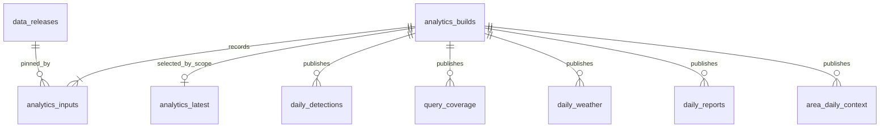

# Understand the dbt analytical layer

The analytical layer turns published native records into consistent summaries for the Node.js backend. It does not infer unique fires, burned area, usable clear-sky negatives or a calibrated risk probability.

## From input releases to one analytical version

1. Take a per-scope lock so two builds cannot publish out of order.
2. Resolve `best_available`, `weather_historical`, `weather_recent` and `reports` in one database query. Missing optional inputs stay missing.
3. Record those immutable release IDs and the model/dependency/code hash in `firebridge.analytics_builds` and `analytics_inputs`.
4. Create a private `fb_build_<uuid>` schema owned by the transformation role.
5. Run real `dbt build`, including all the configured data tests. Each model uses the saved IDs; it never independently reads a changing `latest` pointer.
6. In one transaction, copy all required models into permanent analytical tables, mark the version published, and move `analytics_latest`.
7. Remove the disposable schema. Old published versions remain queryable.

A failed SQL model, failed data test or failed publication leaves the previous version readable. The failed build has an error code and local dbt logs. An unchanged input/code signature reuses the current version. Builds currently recompute a **changed scope in full**; partition-level incremental dbt updates are not implemented. This deliberately handles deletions and zero-row standard replacements correctly. Benchmark larger live scopes before increasing cadence.

Airflow is an outer workflow graph. dbt has its own inner model dependency graph, connected through `ref()` and `source()`. One Airflow task runs a coherent dbt build instead of creating a second scheduling system for every SQL model.

## Tables and relationships



Permanent definitions are in migration `009_analytics_orchestration.sql`. The complete column/type contract is generated in `DB_CONTRACT.json` after migrating the real database.

| Serving view | Row grain | Main fields and meaning |
|---|---|---|
| `latest_analytics` | Scope | `build_id`, fixed `input_releases`, code hash and publication time |
| `analytics_builds` | Build attempt | Status, signature, timestamps, error code, test-artifact URI |
| `analytics_inputs` | Build × input alias | Exact native `release_id` |
| `daily_detections` | Build × source × UTC date | Native count, FRP sample count, mean and maximum MW; includes complete empty partitions |
| `query_coverage` | Build × source family × UTC date | `missing`, `complete_empty`, `complete_with_detections`; period state; observation coverage always unknown |
| `daily_weather` | Build × location × variable × UTC date × weather release | Model/source, coordinates, units, valid sample count, aggregation, completeness and value |
| `daily_reports` | Build × publication date × reports release | Article count, reviewed count and article metadata/URLs |
| `area_daily_context` | Build × UTC date | Separate JSON arrays of satellite summaries, coverage, weather points and reports |
| `task_health` | Ingestion task | Orchestrator, kind, subscription, status, attempt count and safe error code |

Prefix these names with `serving.` in application queries. The underlying `analytics` and `firebridge` tables are not writable by the backend reader.

## Interpret the outputs correctly

### Detections

Counts describe native satellite detections within the whole registered rectangle. A Terra count and an Aqua count may include the same fire observed twice. They remain separate. Standard and NRT partitions use the existing source-publication selection rules: an authoritative empty standard partition can replace a nonempty provisional partition.

FRP mean/max describe the observations included in that source/day. They are not fire energy, burned hectares or normalized cross-sensor severity. Null FRP remains null; `frp_sample_count` shows how many observations support the statistic.

### Query coverage

The date grid spans the minimum to maximum dates present in the pinned satellite release, using the source families present in that release. It detects internal and cross-source date gaps within that range. It does not invent an unrequested sensor or extend coverage to today's date. Use subscription/gap state and requested analysis bounds for dates outside that range.

`complete_empty` means a validated point query returned zero rows. `missing` means that source/date partition is absent. `period_state=open` means the day's time interval was still open when queried. None of these establishes clear-sky observation coverage or absence of fire.

### Weather

Weather is sampled at returned provider coordinates, not averaged over the scope. Historical reanalysis and recent model data retain separate release/source identities. A daily value requires 24 valid hourly samples; incomplete days have `value=null` with sample counts.

Temperature, humidity and wind speed use an hourly arithmetic mean. Precipitation is summed by the **start date of its preceding-hour interval**, so a midnight sample belongs to the previous day's final hour. Boundary days without all required samples remain incomplete. Wind direction is omitted from this daily model because an ordinary arithmetic average is invalid for angles; native values remain accessible.

### Reports and combined context

Articles are grouped by publication date. Reviewed documents are counted separately, rejected documents excluded, and undated articles retained only in the native reports view. Article presence is not evidence of location matching or independent confirmation of a satellite detection. Event claims still require their own geographic and event-date matching.

The context model aggregates each input separately before joining. This prevents, for example, 10 detections × 24 weather hours × 3 articles becoming 720 supposed detections. Empty arrays signal missing context; the AI should state that limitation.

## Backend query examples

Resolve once:

```sql
SELECT build_id, input_releases, published_at
FROM serving.latest_analytics
WHERE scope_key = $1;
```

Then use that fixed ID for every chart/explanation in the response:

```sql
SELECT date_utc, source_id, platform, processing_stream,
       detection_count, frp_sample_count, frp_mean_mw, frp_max_mw
FROM serving.daily_detections
WHERE build_id=$1 AND date_utc >= $2::date AND date_utc < $3::date
ORDER BY date_utc, source_id;

SELECT date_utc, detections_by_source, query_coverage, weather_samples, reports
FROM serving.area_daily_context
WHERE build_id=$1 AND date_utc >= $2::date AND date_utc < $3::date
ORDER BY date_utc;
```

Parameterize all inputs. Save `build_id` alongside the user's scope and date range. `bigint` values may be returned as strings by Node's PostgreSQL driver. For a smaller user-drawn polygon, query the pinned native release with PostGIS; these whole-scope aggregates cannot be relabeled as that polygon's measurements.

Listen on `firebridge_analytics` for a wakeup hint, and poll `serving.latest_analytics` for durable recovery after reconnecting. Source-data publication continues to use its existing source release ledger independently.

## dbt files and debugging

- `dbt/models/staging/`: fixed input releases, source partitions and native detections.
- `dbt/models/*.sql`: the five published analytical models.
- `dbt/models/schema.yml`: model descriptions and built-in tests.
- `dbt/tests/`: partition reconciliation, key uniqueness, pinned inputs, missingness, weather completeness and fan-out checks.
- `deploy/requirements-dbt.lock`: tested dbt dependency versions.
- `data/platform/analytics/<build_id>/console.log`: captured dbt output.
- `data/platform/analytics/<build_id>/target/manifest.json`: model dependencies/lineage.
- `data/platform/analytics/<build_id>/target/run_results.json`: executed nodes and test outcomes; also copied to immutable object storage.

The transformation role can read serving views and owns only its candidate schema. It cannot modify ingestion/source tables. The publisher uses the data-layer owner to validate and commit permanent output. No model should mutate a source release or turn a failed test into an automatically cleaned record.

To reproduce real SQL tests locally after installing the pinned dependencies in a separate dbt environment:

```bash
FIREBRIDGE_TEST_DB=1 FIREBRIDGE_DBT_BIN="$PWD/.venv-dbt/bin/dbt" \
  .venv/bin/python -m pytest -q
```

Tests create and drop their own database. Synthetic fixtures never enter the real imported scopes. Airflow execution is separately verified through the isolated stack described in [DEPLOYMENT.md](DEPLOYMENT.md).
