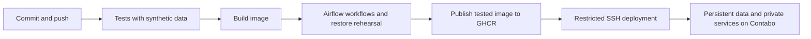

# FIREBRIDGE: GitHub and Contabo deployment from A to Z

Repository: <https://github.com/Nasa-hackathon-FIREBRIDGE/FireBridge-data-pipeline>.

CI means the automatic checks that run when code changes. CD means deploying the exact image that passed those checks. This project uses GitHub Actions for both, GitHub Container Registry (GHCR) for images, and the Contabo VPS for PostgreSQL, Airflow and Python/dbt execution.



## A. What belongs in GitHub

The repository includes Python source, SQL migrations, dbt models, Airflow workflows, Docker/Compose files, tests, operational scripts, architecture documentation and the existing EDA reports/notebooks. The initial MIT license is preserved.

The `.gitignore` excludes `.env`, downloaded NASA data, runtime databases/lake files, local environments, local tools, deployment keys and temporary chart data. Docker's build context also excludes these inputs. Credentials are checked before the initial push; repeat a secret scan before publishing future changes involving configuration or notebook output.

Large NASA archives belong on data storage, not in Git. The code repository and a database/lake backup solve different problems.

## B. Connect the local folder to the repository

The working project folder is:

```bash
cd /home/da-rog/dev_projects/FIREBRIDGE-project
```

The remote is:

```text
git@github.com:Nasa-hackathon-FIREBRIDGE/FireBridge-data-pipeline.git
```

The original GitHub license commit is retained as the parent of the project import. Once the initial import is pushed, normal work uses branches:

```bash
git switch -c improve-weather-pipeline
# Edit the intended files, then review:
git diff
git add src/firebridge/weather.py
git commit -m "Improve weather pipeline validation"
git push -u origin improve-weather-pipeline
```

That filename is an example: stage the files you actually changed. Open a pull request against `main`, inspect its checks, then merge the reviewed change. CI runs on pull requests. Deployment runs only for `main`, after CI succeeds and the deployment switch is enabled.

## C. What CI checks

The workflow is `.github/workflows/data-platform.yml`, named **FIREBRIDGE CI/CD**. Its **Validate data platform** job:

1. Checks out the triggering commit using a pinned official action.
2. Uses Python 3.12 and installs locked runtime/dbt dependencies.
3. Generates private fixture-only configuration and registers its generated credentials with GitHub's log masker.
4. Starts a disposable local PostGIS database and runs Python, PostgreSQL, and real dbt tests.
5. Builds the Airflow application image once, with source/revision labels.
6. Starts the isolated validation stack using that image, parses all six workflows, and runs synthetic ingestion, analytics, archive-import and health workflows.
7. Backs up the synthetic databases, restores the application dump into a disposable database, and verifies referenced objects.
8. Packages deployment source and saves validation evidence.
9. For `main`, publishes the tested image to `ghcr.io/nasa-hackathon-firebridge/firebridge-data-pipeline` with the full commit SHA as its tag. The next job uses its immutable digest.
10. Stops its disposable containers.

Tests and smoke runs use synthetic responses and data; CI does not start a NASA history download. Pull-request runs do not receive VPS deployment credentials or deploy to the server.

Check a run under [repository Actions](https://github.com/Nasa-hackathon-FIREBRIDGE/FireBridge-data-pipeline/actions). Open the workflow, then a job and its individual step. A failing test prevents image publication/deployment. Validation artifacts are retained for 14 days.

## D. Server preparation

The purchased server profile is 6 vCPUs / 12 GB RAM. [CONTABO_SETUP.md](CONTABO_SETUP.md) records the OS security setup and remaining manual account/recovery controls.

Deployment uses a dedicated `firebridge-deploy` account and an Ed25519 key stored locally under ignored `.deploy/`. The server holds only that key's public half. SSH forces it to run the root-owned `/usr/local/sbin/firebridge-cd-gateway` through a narrowly configured sudo rule. It has no interactive shell access, forwarding, or Docker-group membership.

The gateway accepts only:

```text
status
source FULL_COMMIT_SHA SOURCE_SHA256
image FULL_COMMIT_SHA IMAGE_ARCHIVE_SHA256
activate FULL_COMMIT_SHA
rollback FULL_COMMIT_SHA
```

It validates command syntax, upload checksums, source paths, size limits, image labels and image identity. Uploaded links, device files, traversal paths, `.env`, and host-specific configuration are rejected. Deploying application code inherently requires trusting the repository's authorized maintainers and its CI key.

Previously trusted VPS host keys are pinned. Deployment does not accept an arbitrary new SSH host key automatically. Verify any genuine VPS host-key change through a trusted provider-console route before updating the pin.

## E. Authorize the GitHub CLI once

The official GitHub CLI is available locally as `.tools/gh`. From the project folder:

```bash
./.tools/gh auth login --hostname github.com --git-protocol ssh --web --skip-ssh-key --scopes repo,workflow
```

Complete the browser login as the administrator of the repository, and grant organization access if requested. Never paste the resulting token into chat, files in the repository, or workflow YAML. The CLI stores authentication locally and encrypts Actions secrets through GitHub's API.

Check access:

```bash
./.tools/gh auth status
./.tools/gh repo view Nasa-hackathon-FIREBRIDGE/FireBridge-data-pipeline
```

This CLI authorization is for configuring the repository. Actual workflow execution uses GitHub's short-lived `GITHUB_TOKEN` for package publication/pulls.

## F. Configure GitHub Actions and deployment settings

Open the repository's **Settings → Actions → General** and allow the official actions used by the workflow. Keep default workflow permissions at read-only; the workflow explicitly grants package write permission only where image publication needs it. Dependabot proposes updates to pinned GitHub actions weekly.

Create an environment named **production** under **Settings → Environments**. Limit deployment branches to **main**. The pipeline is prepared for automatic deployment after successful CI; any environment protection rules you add will also apply.

Configure these settings:

| Location | Name | Value |
|---|---|---|
| Repository variable | `DEPLOY_ENABLED` | `false` during configuration, then `true` when deployment access has been tested |
| `production` environment variable | `DEPLOY_HOST` | The VPS IP/hostname |
| `production` environment secret | `DEPLOY_SSH_KEY` | Contents of `.deploy/github_actions` |
| `production` environment secret | `DEPLOY_KNOWN_HOSTS` | Contents of `.deploy/known_hosts` |

The private deployment key stays out of chat and terminal output. Using the CLI, upload it directly from the file:

```bash
./.tools/gh secret set DEPLOY_SSH_KEY --env production \
  --repo Nasa-hackathon-FIREBRIDGE/FireBridge-data-pipeline < .deploy/github_actions
./.tools/gh secret set DEPLOY_KNOWN_HOSTS --env production \
  --repo Nasa-hackathon-FIREBRIDGE/FireBridge-data-pipeline < .deploy/known_hosts
```

FIRMS keys, database passwords and Airflow credentials are generated/stored on the VPS in `/opt/firebridge/shared/.env`. They are not required as GitHub deployment secrets. Configure provider keys privately on the server when data collection is deliberately enabled.

## G. Push and run the first pipeline

After the project import is committed:

```bash
git push -u origin main
```

The `push` starts CI. Open Actions and inspect **Validate data platform**. With `DEPLOY_ENABLED=false`, validation/image publication can finish while server deployment stays disabled.

After environment settings and the restricted SSH account have been verified, enable deployment:

```bash
./.tools/gh variable set DEPLOY_ENABLED --body true \
  --repo Nasa-hackathon-FIREBRIDGE/FireBridge-data-pipeline
./.tools/gh workflow run data-platform.yml --ref main \
  --repo Nasa-hackathon-FIREBRIDGE/FireBridge-data-pipeline
```

You can also select **Actions → FIREBRIDGE CI/CD → Run workflow → main**. Subsequent pushes/merges to `main` deploy automatically after checks pass. Public repositories can use deployment environments; settings availability on private repositories depends on the GitHub plan. [GitHub environment documentation](https://docs.github.com/en/actions/how-tos/deploy/configure-and-manage-deployments/manage-environments).

## H. What CD does on the server

The **Deploy to Contabo** job runs after validation, using the `production` environment:

1. Downloads the source bundle from that successful run.
2. Authenticates to GHCR using its short-lived workflow token and pulls the tested image by digest.
3. Streams the compressed image and source bundle over SSH with checksums. This avoids storing long-lived GHCR credentials on the VPS.
4. The VPS loads the image and verifies its source/revision labels. It removes the redundant compressed image archive after loading.
5. The gateway creates `/opt/firebridge/releases/FULL_COMMIT_SHA`, using the shared environment and data directories.
6. Before an upgrade, it pauses previously enabled schedules and waits up to ten minutes for already running or executor-queued tasks to finish. Waiting/downstream work stays recorded in Airflow and resumes after the upgrade; the entire multi-task workflow does not need to finish first. A long history download can exceed this limit; let that running task finish and retry deployment. Do not manually trigger workflows during maintenance.
7. It stops the old Airflow services after draining and backs up both PostgreSQL databases and immutable objects. The first empty deployment has no prior database to back up.
8. It initializes/migrates the databases and Airflow, sets the orchestrator, and starts the new image with the small-server profile.
9. It waits for service health, checks workflow imports and database access, and restores only schedules that were already enabled. New workflows and subscriptions stay paused/disabled.
10. Only after readiness succeeds does it atomically point `/opt/firebridge/current` to the new release and save a deployment receipt.

If startup fails, it attempts to restart the previous code/image and restore its schedules. **Database schema changes are not automatically downgraded.** An incompatible migration may require operator recovery from the pre-deployment backup. Review migrations for compatibility and rehearse them before production changes.

Initial deployment creates a fresh empty data platform. It does not transfer the laptop's existing NASA archives/database or automatically start historical/recent downloads. Plan that data transfer and collection explicitly after service verification.

## I. Server layout and private access

```text
/opt/firebridge/
  current -> releases/FULL_COMMIT_SHA
  releases/FULL_COMMIT_SHA/       source and host release settings
  shared/.env                    private persistent configuration
  shared/data/                   persistent input objects, lake and backups
  shared/deployment.json         last successful deployment receipt
  shared/deployments/             private logs per release
  inbox/                         verified incoming release metadata/source
```

Named Docker volumes retain both PostgreSQL databases. Source/image releases are separate from persistent data. Do not use `docker compose down -v` on production. No automatic image or database-volume pruning is configured; monitor growth and keep images/source needed for rollback.

Use your ordinary administrator account for server work. Administrative files below `shared` are root-readable; use sudo in your own terminal when needed. The CI account deliberately exposes only its restricted protocol.

Open Airflow privately from the laptop:

```bash
ssh -N -L 18080:127.0.0.1:8080 dataadmin@YOUR_VPS_IP
```

Then visit <http://localhost:18080>. Retrieve Airflow credentials privately from the VPS `.env`, without posting them into chat. Database and Airflow ports remain bound to localhost. The Node.js application and public HTTPS/domain routing are separate application work.

Read CI deployment status with the dedicated local key:

```bash
ssh -i .deploy/github_actions -o IdentitiesOnly=yes \
  -o StrictHostKeyChecking=yes -o UserKnownHostsFile=.deploy/known_hosts \
  firebridge-deploy@YOUR_VPS_IP status
```

This returns the last saved deployment receipt. For live service state, use the administrator terminal:

```bash
sudo sh /opt/firebridge/current/scripts/stack.sh ps
sudo tail -n 80 /opt/firebridge/shared/deployments/FULL_COMMIT_SHA.log
```

Review private logs locally: they may contain generated configuration or diagnostic details and should not be pasted unfiltered into public issues.

## J. Update, pause deployment, and recover

For a normal update, create a branch, commit, push, inspect CI, and merge into `main`. The merged commit receives its own image, release directory, deployment log and readiness checks.

To stop future automatic deployments while investigating:

```bash
./.tools/gh variable set DEPLOY_ENABLED --body false \
  --repo Nasa-hackathon-FIREBRIDGE/FireBridge-data-pipeline
```

That switch does not cancel an already running deployment. GitHub and server locks serialize deployments; do not interrupt an active database migration.

For a code rollback, choose a previously healthy revision whose image/release are retained, confirm database compatibility, then invoke:

```bash
ssh -i .deploy/github_actions -o IdentitiesOnly=yes \
  -o StrictHostKeyChecking=yes -o UserKnownHostsFile=.deploy/known_hosts \
  firebridge-deploy@YOUR_VPS_IP 'rollback FULL_PREVIOUS_COMMIT_SHA'
```

The gateway uses the retained release and local verified image, with the same drain/backup/readiness procedure. This is a code rollback; recover an incompatible database separately using the backups and [DEPLOYMENT.md](DEPLOYMENT.md).

## K. Backups and the first data run

Before enabling data collection, configure off-VPS backup storage and external alert delivery. The deployment backup covers both databases and referenced immutable objects; the additional Parquet history lake needs its own backup. A backup on the VPS alone does not cover loss of the VPS. Preserve the private environment and Airflow Fernet key in encrypted storage and rehearse restoration.

Check the empty platform first. Transfer existing validated data if desired, then configure the intended provider keys/subscriptions. Trigger one bounded request and inspect its result before enabling broader collection. Full-history downloads are long-running jobs and should be scheduled around release maintenance on this 12 GB server.

The stack currently runs the data platform: PostgreSQL/PostGIS, Airflow, Python pipelines and dbt. The backend team's Node.js HTTP API and AI explanation application have their own repository/deployment requirements.
