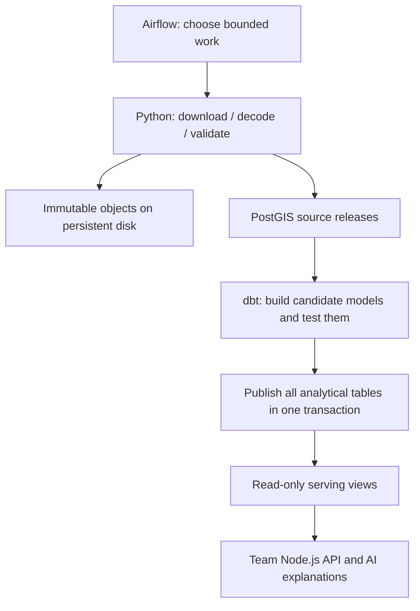

# Run FIREBRIDGE on a single VPS

**Current purchased server:** Contabo Cloud VPS Plus 6. Start with [CONTABO_SETUP.md](CONTABO_SETUP.md) for OS security, SSH access, firewall policy and the 12 GB resource profile. The default limits below were prepared for the earlier proposed **16 vCPU / 32 GB / 320 GB Hetzner server**; do not apply those limits unchanged to the smaller Contabo VPS. Verify the actual installed Ubuntu release before bootstrapping. This is a single-server deployment; local validation is separate from remote installation.

After the server's security baseline passes, review [ANALYTICS.md](ANALYTICS.md), prepare the source bundle, and follow sections 3–8. No new manual downloads are required to deploy historical data already loaded. Restore existing data before enabling recent collection; archives/backfills fill older gaps separately.

The local verification on November 2, 2026 passed 38 automated tests, all four Airflow workflows, both dependency checks, service health checks and a disposable application-database restore. The workflow/restore rehearsal used an isolated synthetic dataset; live provider fetching and a remote VPS deployment have not been verified. Receipts are linked in [README.md](README.md#current-airflow-and-dbt-verification).

## 1. What runs on the server

| Service | What it does | Configured limit |
|---|---|---|
| `db` | FIREBRIDGE PostgreSQL 16 + PostGIS; source data, releases, analytical tables | 4 CPUs / 6 GB |
| `airflow-db` | Airflow's own schedules, users, task history | 2 CPUs / 2 GB |
| `airflow-api` | Authenticated Airflow interface and task execution API | 2 CPUs / 3 GB |
| `airflow-scheduler` | LocalExecutor; runs Python ingestion and dbt subprocesses | 6 CPUs / 10 GB |
| `airflow-dag-processor` | Discovers workflow definitions | 2 CPUs / 2 GB |

These are ceilings, not reservations. Airflow allows four concurrent tasks; the ingestion pool allows two and the analytics pool allows one. dbt uses two database connections. Leave memory for Linux, filesystem caches and your Node.js backend; benchmark before increasing concurrency.

Airflow and dbt are pinned in `deploy/Dockerfile.airflow`. dbt runs in a separate Python environment to avoid dependency conflicts with Airflow. Neither Redis nor Kubernetes is required by this LocalExecutor deployment.



**Data ownership:** Python owns ingestion, native validation and source publication. dbt owns candidate analytical models. The publication code copies validated candidates into versioned analytical tables. SQL migrations own permanent schemas and permissions. The Node.js team owns HTTP endpoints and the AI application.

## 2. Prepare a source bundle on your laptop

From the project root:

```bash
python3 scripts/package_release.py
```

The printed `dist/firebridge-<timestamp>.tar.gz` contains code, migrations, dbt, workflows and instructions. It deliberately excludes `.env`, downloaded data, database volumes and virtual environments. Transfer the exact printed filename:

```bash
scp dist/firebridge-<timestamp>.tar.gz YOUR_USER@YOUR_SERVER_IP:/tmp/
```

Replace placeholders with your real filename and SSH details. Provision SSH-key access when creating the VPS. Keep SSH open only to your administrative IP where practical. The deployment exposes no database or Airflow port on the public interface.

## 3. Install the server prerequisites

On the VPS, using your regular administrative account:

```bash
sudo install -d -o "$USER" -g "$(id -gn)" /opt/firebridge
tar -xzf /tmp/firebridge-<timestamp>.tar.gz -C /opt/firebridge
cd /opt/firebridge
sudo sh scripts/bootstrap_ubuntu.sh
sudo usermod -aG docker "$USER"
```

Log out and reconnect so Docker group membership takes effect. Docker access grants administrative control of the host; give it only to administrators. The bootstrap follows Docker's official Ubuntu package repository instructions and is intended for a fresh Ubuntu VPS. If Docker is already installed, verify it rather than replacing it. Require Docker Compose **2.24.4 or newer** for the optional validation override.

```bash
docker version
docker compose version
python3 --version
```

No host Python virtual environment is required to run the production stack. Python on the host only generates configuration and runs administration scripts; application dependencies are inside the image.

## 4. Generate private configuration

```bash
cd /opt/firebridge
python3 scripts/init_server.py
```

This creates or extends a mode-0600 `.env` without overwriting existing values. It generates separate application, reader, transformation, metadata-database and Airflow administrator credentials, plus Airflow encryption/signing keys. It chooses a non-root runtime UID matching your account.

Edit `.env` privately to add `FIRMS_MAP_KEY` when ready. Keep `EARTHDATA_TOKEN` empty unless implementing protected science-file acquisition. Adding either key does not enable any subscription.

Do not commit `.env`, paste it into logs, or run an unfiltered `docker compose config` in shared logs. `sh scripts/stack.sh config --quiet` validates configuration without printing resolved secrets. Changing an initialized PostgreSQL password in `.env` alone does not rotate the database role; change both deliberately. Preserve Airflow's Fernet key when restoring its metadata database.

## 5. Choose initial data: transfer existing work or start empty

### Recommended: transfer your existing historical database

You already have useful local imports. Do not download them again or load all global archives blindly.

On the laptop:

```bash
sh scripts/backup_database.sh
```

Copy the printed application dump to the VPS and copy `data/platform/objects/` with `rsync` over SSH. Original objects are content addressed; preserving their names is essential:

```bash
scp data/platform/backups/firebridge-<timestamp>.dump YOUR_USER@YOUR_SERVER_IP:/tmp/
rsync -a --info=progress2 data/platform/objects/ YOUR_USER@YOUR_SERVER_IP:/opt/firebridge/data/platform/objects/
```

Create the destination directory first if needed. Run the following on the VPS **before running the application initializer**, while its application database is empty:

```bash
sh scripts/stack.sh up -d --wait db
sh scripts/stack.sh exec -T db pg_restore -U firebridge -d firebridge \
  --no-owner --no-privileges --exit-on-error < /tmp/firebridge-<timestamp>.dump
```

Do not use this command against a populated application database. It intentionally has no `--clean` flag. Initialization in the next step applies missing migrations and grants the new server's reader/transform roles. You do not need to reuse your laptop's database password. Do not overwrite the initialized VPS `.env` with the laptop `.env`.

### Alternatively: start with an empty database

Skip restoration and run initialization below. Upload selected historical ZIP/CSV files into `/opt/firebridge/data/imports/` and use the archive workflow in section 9. An empty fresh deployment will have source definitions and disabled subscriptions but no real detections.

## 6. Build and start the stack

```bash
sh scripts/deploy_server.sh
```

The script builds the image, stops the legacy `worker` service, starts the two databases, prepares mount roots, applies Airflow and FIREBRIDGE migrations, creates the administrator and task pools, registers disabled pilot subscriptions, selects Airflow as the ingestion owner, and starts the services.

**First server deployment:** all six workflows start paused and new subscriptions are disabled. The additional local-archive and full-history workflows are manual. `start_local.sh` has a separate local startup policy that explicitly launches history acquisition; see [FULL_HISTORY.md](FULL_HISTORY.md). **Repeat deployment:** existing subscription and pause settings are preserved; the script does not silently disable working services. Follow the upgrade procedure before rerunning on an active server.

```bash
sh scripts/stack.sh ps
sh scripts/stack.sh logs --tail=100 airflow-scheduler airflow-dag-processor
sh scripts/stack.sh exec -T airflow-scheduler firebridge status
```

Wait for services to become healthy. `db` uses the existing named volume; routine stopping never removes it. Never use `down -v` against the real stack.

## 7. Open the private Airflow interface

Airflow binds to **127.0.0.1:8080 on the VPS**. From your laptop:

```bash
ssh -N -L 8080:127.0.0.1:8080 YOUR_USER@YOUR_SERVER_IP
```

Keep that session open and visit `http://localhost:8080`. Sign in with `AIRFLOW_ADMIN_USER` and `AIRFLOW_ADMIN_PASSWORD` from the VPS's private `.env`. Use your editor or password manager to read them; do not copy them into chat.

This setup uses Airflow's FAB authentication manager. Keep the interface private. If the team later needs a public domain, add a TLS reverse proxy and deliberately configure authentication/proxy settings before changing the bind address. Docker-published ports can bypass ordinary UFW rules, so do not rely on UFW alone to protect a publicly bound port.

## 8. Start analytics using the already-loaded data

For a bounded first check:

```bash
sh scripts/stack.sh exec -T airflow-scheduler firebridge build-analytics --scope morocco-pilot
```

Use a scope that actually exists in your restored database. The command runs real dbt models and tests, then publishes a complete analytical version. It makes no NASA/weather/news requests. Failed builds preserve the previous published version.

In Airflow, enable **`firebridge_analytics`** and trigger it once. It discovers scopes with published satellite releases; unchanged inputs/model code return `unchanged`. It then runs every hour at minutes 7 and 37.

Check the backend-facing result:

```bash
sh scripts/stack.sh exec -T db psql -U firebridge -d firebridge -c \
  'SELECT scope_key,build_id,published_at FROM serving.latest_analytics;'
```

The first version includes daily native detections, query-return coverage, weather summaries, dated-report metadata and a combined context table. Missing weather/news remains unavailable. See [ANALYTICS.md](ANALYTICS.md) for scientific interpretation and SQL examples.

## 9. Historical data: archives and backfills

### Import a downloaded archive through Airflow

Place a CSV/ZIP in `data/imports/`. The scheduler sees it read-only under `/imports`. Enable the manual **`firebridge_archive_import`** workflow and trigger it with a JSON configuration like this, after replacing the filename and dates with the actual archive request bounds:

```json
{
  "path": "my-modis-archive.zip",
  "format": "firms",
  "feed": "MODIS_SP",
  "scope": "morocco-pilot",
  "bbox": [-6.4, 34.5, -4.5, 35.9],
  "start": "2024-01-17",
  "end": "2025-01-18",
  "coverage_start": "2024-01-01",
  "coverage_end": "2025-01-18"
}
```

All ends are **exclusive UTC**. Coverage is the original download request's support, not the first/last observed hotspot. A ZIP must contain exactly one CSV. To import the existing audited MODIS Parquet, use `format: audited_modis` and a `.parquet` path; its provenance columns are required. Ordinary arbitrary Parquet files are unsupported.

The workflow validates/imports the archive and then builds its analytical scope. It is manually triggered, not periodically scheduled. Large global archives may exceed the four-hour import task limit; split source/date windows deliberately. Landsat FIRMS only supports US/Canada; retain its geographic limits.

### Backfill dates available through the provider API

Register a bounded subscription with explicit dates, initially disabled:

```bash
sh scripts/stack.sh exec -T airflow-scheduler firebridge subscribe \
  --feed MODIS_SP --mode backfill --scope morocco-pilot \
  --bbox=-6.4,34.5,-4.5,35.9 --start 2025-01-18 --end 2025-02-01
```

Inspect availability before enabling the returned subscription ID. The planner enqueues bounded batches of up to 31 daily windows per planning cycle. When enumeration finishes, `planning_complete=true` stops further planning while queued work and gap repair remain authorized. An explicit disable stops further attempts, including backfill retries. Dates outside the API's available history require archives; Airflow does not extend NASA's retention. An Airflow backfill of scheduler timestamps is not a substitute for this explicit data-window backfill, so the ingestion Dag has `catchup=False`.

The historical imports previously verified in this repo end on January 17, 2025. Hourly recent updates do not fill the intervening history. Use remaining local archives and explicit backfills to cover the gap you actually need.

## 10. Enable recent data deliberately

First check the provider, then inspect subscriptions:

```bash
sh scripts/stack.sh exec -T airflow-scheduler firebridge availability
sh scripts/stack.sh exec -T airflow-scheduler firebridge status
```

The availability command makes an external NASA request. Select one available feed's **incremental** subscription for the pilot, then replace the placeholder:

```bash
sh scripts/stack.sh exec -T airflow-scheduler firebridge enable SUBSCRIPTION_UUID
```

Enable **`firebridge_ingestion`** in Airflow and trigger it. It checks due subscriptions every 15 minutes; each subscription retains its own hourly/daily cadence and overlap from [OPERATIONS.md](OPERATIONS.md). The Dag displays one mapped task per queued window. Verify a downloaded payload, completed task and published source release before enabling more feeds.

The live collection rectangles are limited to 100 square degrees. Global live collection requires a separate shard/central-feed design. Check availability for every platform; a discontinued or unavailable feed is not silently replaced with a different satellite. Hourly polling does not imply hourly satellite observations.

Provider budget/availability waits are marked deferred and remain queued until due; Airflow shows those attempts as skipped. Network failures raise task errors and use Airflow retries. Authentication/schema failures block the task and disable the affected subscription. A green Dag with only deferred tasks does not prove fresh data: inspect `serving.task_health` and data freshness too.

```bash
sh scripts/stack.sh exec -T airflow-scheduler firebridge disable SUBSCRIPTION_UUID
# After diagnosing/fixing a blocked or failed subscription:
sh scripts/stack.sh exec -T airflow-scheduler firebridge resume SUBSCRIPTION_UUID
```

`resume` requeues failed/blocked windows. The old continuously running Python worker is prohibited while Airflow owns ingestion. To change ownership, stop the other scheduler, wait for active tasks to finish, then use `firebridge orchestrator local|airflow`.

## 11. Add weather, news and science work

Weather subscriptions already have adapters. Enable a pilot weather subscription after a bounded live check. Historical ERA5 and recent model context are separate products. Weather is point-sampled; it is not an average over an arbitrary area. Dated reports preserve review status, and news publication dates are not incident dates.

RSS requires an approved feed URL, publisher and explicit hostname allowlist in `.env`. Provider settings changed in `.env` require recreating affected containers. Configure and validate sources using [OPERATIONS.md](OPERATIONS.md); no example news source is silently trusted or enabled.

CMR subscriptions can catalog science-file revisions. **Science-file downloading, mask/geolocation decoding, usable negative observations, harmonization training and fire-incident inference are not implemented by this Airflow/dbt addition.** The existing raw-science research experiment remains separate.

## 12. Backend connection

Your Node.js container should join the application Compose network and use `db:5432`, database `firebridge`, user `firebridge_reader` and the private reader password. An external development machine can use an SSH tunnel to the VPS's loopback port 55432. Keep database ports private.

Resolve `serving.latest_analytics` once and retain `build_id` for the complete API response/saved analysis. Query the analytical serving views with that ID. The build records the fixed satellite/weather/report release IDs. Arbitrary selected polygons need spatial filtering of the native pinned release; a registered-scope summary is not automatically valid for a smaller polygon.

See [NODE_HANDOFF.md](NODE_HANDOFF.md). The AI agent should explain backend-prepared evidence, preserve units/missingness and cite the underlying release and report URLs. No unrestricted SQL tool is needed.

## 13. Backups and recovery

Run a backup:

```bash
sh scripts/backup_stack.sh
```

It creates custom-format dumps for both databases, mirrors immutable object files once, hashes the dumps, and updates `LATEST` only after completion. It uses a lock to avoid overlapping backup jobs and never deletes older objects. `FIREBRIDGE_BACKUP_DIR` can select a different mounted disk. On one host, a local backup does not protect against VPS loss: copy the whole backup root to separate storage. Keep `.env` in a separate encrypted password/secret backup; the ordinary bundle excludes it.

Rehearse restoration into an automatically named disposable application database:

```bash
python3 scripts/restore_rehearsal.py --backup-root data/platform/backups/server
```

The rehearsal checks dump hashes, restores into a new database, reads the serving views, verifies referenced object hashes, and removes only its disposable database. It never changes the live database. It does not rehearse a full Airflow metadata restoration; for that, restore the Airflow dump to a fresh metadata instance using the matching Airflow version and saved Fernet key.

Install daily backups and independent health checks on the VPS:

```bash
sudo cp deploy/firebridge-backup.service deploy/firebridge-backup.timer /etc/systemd/system/
sudo cp deploy/firebridge-health.service deploy/firebridge-health.timer /etc/systemd/system/
sudo systemctl daemon-reload
sudo systemctl enable --now firebridge-backup.timer firebridge-health.timer
systemctl list-timers 'firebridge-*'
```

Units assume `/opt/firebridge`; edit paths if you installed elsewhere. They are supplied but not installed on your laptop. Backup retention/offsite copying is an operator responsibility in this version. Do not prune content-addressed objects while retained releases or backups reference them.

For disaster recovery, provision a fresh server, restore the application dump into its empty database before initialization (section 5), restore the object mirror, initialize the application roles, then build/start the matching image. Restore Airflow metadata separately if you need run history; otherwise initialize new metadata with paused Dags and deliberately restore schedules. Validate results before reconnecting the backend.

## 14. Monitoring, failures and disk growth

```bash
sh scripts/check_server.sh
sh scripts/stack.sh exec -T airflow-scheduler firebridge health
sudo journalctl -u firebridge-backup.service -u firebridge-health.service --since today
df -h /opt/firebridge
docker system df
```

Enable **`firebridge_health`** for visible Airflow health runs. The independent systemd check also detects unhealthy/stopped services, because a failed scheduler cannot reliably monitor itself. Data checks cover blocked/failed tasks, overdue subscriptions, missing recent successful tasks, stalled builds, stale analytical inputs and less than 5 GiB free disk. Set an external host/uptime monitor and notification destination for unattended operation; no email, Slack or SMS delivery is configured here.

The 320 GB disk must hold PostgreSQL, original objects, versioned releases, images and backups. Repeated weather queries and corrected snapshots create new versions. Check growth early; keep plenty of headroom and move backups off-host. Old analytical versions and objects are retained indefinitely in this implementation. Airflow database/task-log retention also needs a policy; Docker stdout logs alone are capped automatically.

If a process is killed during a dbt build, the previous analytical version remains readable. A `building` ledger row and `fb_build_<uuid>` schema may remain; the health check flags old builds. Inspect the corresponding task before marking the build failed and dropping only that exact candidate schema. Do not delete published versions to fix a failed candidate.

## 15. Update or stop the server

For an update: pause ingestion/analytics/archive Dags, wait for running tasks to finish, make a verified backup, retain the previous image tag, install the new source bundle, run `deploy_server.sh`, inspect import errors and health, then restore the intended pause settings. Add migrations; never edit a migration already applied to the database. Rebuild when changing Python, SQL models or Dags, because they are baked into the image.

```bash
sh scripts/stack.sh stop
# Later, start existing initialized services without rebuilding:
sh scripts/stack.sh up -d db airflow-db airflow-api airflow-scheduler airflow-dag-processor
```

Changing the model code triggers new analytical versions on the next build. Failed model tests prevent analytical publication but do not erase valid native source releases.

## 16. Reproduce the isolated validation locally

The `validation` stack uses separate named volumes, application port 55433, Airflow port 8081, and `data/platform-validation`. It never uses your real application database or object store.

```bash
python3 scripts/init_server.py
FIREBRIDGE_STACK=validation sh scripts/deploy_server.sh
FIREBRIDGE_STACK=validation sh scripts/stack.sh run --rm --no-deps \
  -e FIREBRIDGE_VALIDATION=isolated-firebridge-validation airflow-init \
  python /opt/firebridge/deploy/seed_validation.py
FIREBRIDGE_STACK=validation .venv/bin/python scripts/smoke_airflow.py
FIREBRIDGE_STACK=validation sh scripts/stack.sh stop
```

The smoke script requires the local `.venv` with this project's runtime dependencies. It uses explicitly synthetic data, authenticates to Airflow, triggers real scheduler/LocalExecutor runs, verifies the published results and pauses the Dags afterwards. It never enables a provider subscription. Its receipt is [airflow-smoke-verification.json](airflow-smoke-verification.json).

For a new checkout, create that environment before running the smoke script:

```bash
python3 -m venv .venv
.venv/bin/pip install -r requirements-data.lock
.venv/bin/pip install -e '.[test]'
```

On Ubuntu, creating a local virtual environment may require `sudo apt-get install python3-venv`. This environment is for development checks; the production services run inside Docker.

## Source references

- [Airflow LocalExecutor](https://airflow.apache.org/docs/apache-airflow/stable/core-concepts/executor/local.html): execution on one scheduler host.
- [Airflow Docker guidance](https://airflow.apache.org/docs/apache-airflow/stable/howto/docker-compose/index.html): Docker operational considerations; the upstream quick-start alone is not a complete production deployment.
- [FAB authentication manager](https://airflow.apache.org/docs/apache-airflow-providers-fab/stable/auth-manager/index.html): Airflow user authentication and authorization.
- [dbt PostgreSQL adapter](https://docs.getdbt.com/docs/local/connect-data-platform/postgres-setup): SQL transformation connection.
- [Docker Ubuntu installation](https://docs.docker.com/engine/install/ubuntu/): package installation and Docker firewall behavior.
