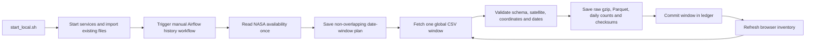

# Download the full FIREBRIDGE satellite history

## Start when you are ready

From the project folder:

```bash
./start_local.sh
```

This now sets up the local services, loads the existing files, and **starts or resumes a separate full-history NASA FIRMS download in Airflow**. It returns after the services are ready and the download has been dispatched. It does not wait for years of data to finish downloading. Keep the computer powered on, Docker running, and internet connected. You may close the terminal once startup finishes.

The configured private `FIRMS_MAP_KEY` is sufficient for these fire-detection CSVs. An Earthdata token is not needed. No manual archive requests, email links, or yearly ZIP downloads are required for this route.

To start the services without starting a new download:

```bash
./start_local.sh --skip-download
```

That flag does not cancel an already running download. `./stop_local.sh` stops the local stack, including download execution, and preserves all files and database volumes. Run `./start_local.sh` again to resume. Airflow also retries transient execution failures; completed date windows are checksum-verified and skipped on a rerun.

**Implementation status:** the workflow is prepared and tested with fixtures. The full historical download has not been started by the assistant. Small historical API probes used earlier to verify access were not retained as an archive. Running the launcher is the user's start action.

## What “all history” means

The scope is the active-fire/hotspot point products for the project satellite groups. This is not every imagery, atmospheric, ocean, or science-swath product produced by NASA.

| Satellite | Historical starting point | Geographic scope |
|---|---|---|
| MODIS Terra | November 2000 | Global |
| MODIS Aqua | July 2002 | Global; included in the combined MODIS feed |
| VIIRS S-NPP | January 20, 2012 | Global |
| VIIRS NOAA-20 | April 1, 2018 | Global |
| VIIRS NOAA-21 | March 1, 2023, through the standard feed | Global |
| Landsat 8 and 9 fire detections | June 20, 2022, combined product | FIRMS US/Canada footprint |

The first run asks NASA's [data-availability API](https://firms.modaps.eosdis.nasa.gov/api/data_availability/) for the actual ranges. The table describes the product record, not proof that every satellite/day/location contains detections. [NASA FIRMS archive coverage](https://firms.modaps.eosdis.nasa.gov/download/) and [MODIS platform start dates](https://firms.modaps.eosdis.nasa.gov/content/active_fire/).

The run freezes its target at the **latest completed UTC day**, limited by the provider's available dates. This avoids treating a partly collected current day as complete. The precise cutoff is recorded in `data/platform/lake/history/plan.json`.

For each sensor family, the plan uses standard processing first. It adds the NRT tail only after the standard period ends, so the two streams do not overlap. NASA's Landsat point feed is NRT only. Recent rolling NRT windows are acquired first because they expire; the older windows then alternate between satellite families, beginning at their earliest available dates. Any gap between NASA's published standard and NRT ranges remains explicit in the plan.

## Follow progress and inspect data

```bash
./history_status.sh
```

This prints the last checkpoint, completed/remaining date windows, downloaded row count, retained size, disk space, and any failure code. It performs no network requests. A timestamped checkpoint is not a live process-health check: use Airflow to see whether execution is running, waiting, failed, or finished.

- [Airflow](http://localhost:8080): open `firebridge_full_history_download`, then the `download_history` task and its log. Use credentials from private `.env`.
- [DuckDB data browser](http://localhost:4213): expand **`history` → `main`** for newly downloaded full history. The separate **`nasa` → `main`** catalog continues to show the files already loaded from the laptop.
- [PostgreSQL browser](http://localhost:8082): existing validated serving releases. Full global history is not automatically inserted into PostGIS.

The history catalog appears after starting the new workflow through the launcher. Its views discover newly committed files as acquisition advances; rerun your SQL query to refresh the results.

```sql
-- How much has actually downloaded? This is not the provider's planned range.
SELECT * FROM history.main.satellite_inventory ORDER BY satellite, processing_stream;

-- Completed versus remaining requests, per source:
SELECT feed, status, count(*) AS windows, sum(rows) AS source_rows
FROM history.main.request_inventory
GROUP BY feed, status ORDER BY feed, status;

-- Inspect exactly which requested periods succeeded, including empty responses:
SELECT feed, start, end_exclusive, status, rows, error_code
FROM history.main.request_inventory
ORDER BY feed, start;

-- Look at older detections as soon as their windows have finished:
SELECT * FROM history.main.detections
WHERE satellite='Terra'
  AND date_utc >= DATE '2001-01-01' AND date_utc < DATE '2001-02-01'
LIMIT 100;
```

Do not add counts from `nasa` and `history`: their recent years overlap. The full-history catalog is a separate acquisition, so the original files and published releases remain available for comparison. Source rows are not unique fire incidents, burned area, or clear-sky observation coverage. Native confidence scales differ by instrument. `version_raw` preserves any RT/URT version labels supplied within an NRT response; this exploratory layer does not promote them to validated NRT serving data.

## How the download works



1. A file lock and Airflow's single active-run setting prevent concurrent history writers.
2. A durable SQLite ledger records every requested period. Windows contain at most five days, matching the [FIRMS Area API](https://firms.modaps.eosdis.nasa.gov/api/area/).
3. Requests share the existing PostgreSQL FIRMS budget with subscribed ingestion. Global history caps itself at **20 HTTP requests per ten minutes**, including availability, or a smaller configured budget. This differs from NASA's transaction counter: the observed five-day world queries cost multiple transactions each. FIRMS can return **HTTP 400 with “Exceeding allowed transaction limit.”** as well as HTTP 429. Both trigger a shared cooldown of at least ten minutes, preserving the pending window without consuming failure retries. `waiting_for_provider` is an expected wait; `failed` requires investigation. A full history can take many hours or longer, depending on throttling, network speed, and disk capacity. No fixed completion time is promised.
4. Network errors and server throttling retry with waiting. Missing credentials, changed CSV schemas, wrong satellites, corrupt coordinates, and invalid dates stop visibly. HTTP error bodies are not accepted as empty data.
5. Valid CSV responses are retained as gzip, without changing their decompressed bytes. Every source row is written to compressed Parquet. Invalid numeric FRP remains visible as raw data, with the convenient nonnegative FRP field null when invalid. Landsat does not acquire invented FRP values.
6. Only after raw data, Parquet, daily summaries, and a checksum receipt have been written does the ledger mark the window complete. Browser views join against that committed inventory. Incomplete or failed writes stay outside the visible history results.
7. A valid header-only response records a completed window with zero rows. Missing requests remain pending or failed; they are never represented as zero detections.
8. A rerun verifies completed artifacts and resumes the frozen plan. It does not append duplicate copies of completed request windows. If a local checksum fails, the run stops with that window marked failed; investigate storage integrity before retrying.

The workflow has a seven-day execution timeout and checkpointed recovery. Its Airflow schedule is `None`: it runs only when launched or explicitly re-triggered. It uses one ingestion pool slot while running. This is an initial archive backfill, not the recurring near-real-time subscription workflow. Existing subscription settings remain unchanged. Once history completes, use [OPERATIONS.md](OPERATIONS.md) to configure ongoing collection for the intended serving areas. To acquire a later historical cutoff, plan a new acquisition explicitly; rerunning this frozen plan alone does not extend its date range.

## Storage and stopping conditions

The laptop had approximately **24 GiB free** when this extension was prepared. The complete history may exceed the available space. The downloader keeps an **8 GiB reserve**, plus room for an in-flight response and conversion, and stops with `paused_disk` before consuming that reserve. Airflow then shows a failed task requiring operator action; already completed windows remain usable.

Do not delete the existing ZIPs or database volumes to make the run look complete. If the reserve is reached, free unrelated space or move the whole project/lake to larger storage, preserve its directory layout, then rerun the launcher. This implementation does not claim that the complete global archive will fit on the current laptop.

Files are stored under `data/platform/lake/history/`:

| Path | Purpose |
|---|---|
| `plan.json` | Frozen provider availability, target cutoff, explicit provider gaps |
| `ledger.sqlite3` | Durable status and checksums per requested window |
| `raw/*.csv.gz` | Original response bytes, gzip compressed |
| `parquet/*.parquet` | All source rows and provenance |
| `daily/*.parquet` | Per-window daily counts for fast inventory queries |
| `receipts/*.json` | Checksums, source columns, timestamps, sanitized request details |
| `requests.parquet` | Atomically published request-status inventory |
| `catalog.duckdb` | Small read-only browser catalog over the files |
| `progress.json` | Last recorded execution checkpoint |

Back up the entire history directory together. The existing PostgreSQL backup script does not include this lake. Credentials are read from private configuration and never placed in the plan, filenames, receipts, or progress logs.

The Node.js team's validated PostgreSQL interface and dbt results are unchanged. Publishing selected portions of this new history into canonical serving releases is a separate processing step; this acquisition makes the full source history downloadable and explorable without expanding hundreds of millions of points into a laptop-sized indexed PostgreSQL database.
