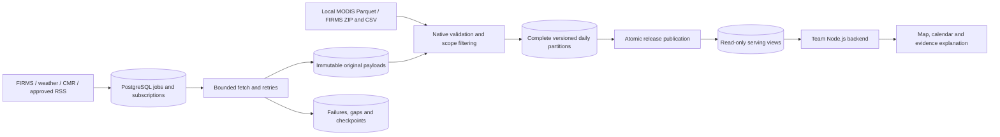

# FIREBRIDGE data engineering

For the current Airflow/dbt extension, use [DEPLOYMENT.md](DEPLOYMENT.md) for server installation and operation and [ANALYTICS.md](ANALYTICS.md) for model definitions, publication behavior and backend queries. Airflow owns scheduled execution after an explicit ownership switch; the existing local worker remains an alternative. The historical verification counts below describe the initial local-data implementation and are retained as provenance.

This is the **implemented data layer**. Python owns acquisition, validation, historical imports, scheduled updates and publication. PostgreSQL/PostGIS stores the catalog, data, releases and operational state. Your backend team owns the **Node.js HTTP API**, user authentication, selected-area analyses and AI explanation service. No Python HTTP server is included.

Use [OPERATIONS.md](OPERATIONS.md) to run it and [NODE_HANDOFF.md](NODE_HANDOFF.md) to connect the backend. The original [database dictionary](../architecture/DATABASE.md) explains the scientific and application tables; the executable, checksum-checked migrations in [`src/firebridge/migrations`](../../src/firebridge/migrations/) are authoritative for the installed database. Later application/scientific tables are reserved and may be empty.

## What works

| Pipeline | Historical path | Update path | Current verification |
|---|---|---|---|
| MODIS Terra/Aqua | Audited existing Parquet or FIRMS ZIP/CSV | FIRMS SP/NRT, split by satellite | Real local MODIS import + database tests |
| VIIRS S-NPP / NOAA-20 / NOAA-21 | Stream ZIP/CSV with declared coverage | Separate SP/NRT feeds and source IDs | Real local pilot archive imports + database tests |
| Landsat 8/9 FIRMS | Stream ZIP/CSV | LANDSAT_NRT, US/Canada only | Local California archive import; native scan/track preserved as positions |
| ERA5 weather | Explicit archive requests in ≤31-day chunks | Daily overlap over recent available history | HTTP fixtures and database tests; no live weather requested in this run |
| Recent model weather | Model-based recent hourly values | Hourly point-context refresh | Same tested adapter; issue time remains null when unavailable |
| Dated reports | Local JSON metadata and reviewed event claims | Approved RSS/Atom metadata feeds | Fixture parsing and versioned database tests |
| Science products | CMR inventory by pinned collection and dates | `updated_since` overlap can find old-granule revisions | Fixture pagination/inventory tests; decoding and companion checks are not implemented |

**External polling is disabled.** The FIRMS key is configured privately in `.env`; provider access has not been exercised with it. Downloaded local records and fixture-only tests are clearly separate. The task queue is PostgreSQL-backed; Redis, Celery and an HTTP service are not required.

The [verification receipt](verification.json) records the actual installed migrations, source counts, release IDs and reader-permission checks. The [machine-readable view contract](DB_CONTRACT.json) lists each exposed column and PostgreSQL type.

## Loaded and checked locally

All three scopes below cover January 17, 2024 through January 17, 2025 inclusive.

| Scope | Published native records | Data |
|---|---:|---|
| `global` | 4,876,343 | MODIS Terra/Aqua standard |
| `morocco-pilot` | 1,034 | Terra 22; Aqua 35; S-NPP 311; NOAA-20 342; NOAA-21 NRT 324 |
| `california-demo` | 12,057 | Landsat 8/9 NRT in the rectangle −122,38,−120,40 |

At the initial local-data milestone, the database had 55 tables, 16 read-only serving views and eight applied migrations. All 27 automated tests passed; the Docker worker completed an idle cycle successfully. Replaying the pilot MODIS import left its release IDs unchanged. A local database backup was created and hashed. No real weather or news records were fabricated or loaded from the test fixtures into the project database.

## Current Airflow and dbt verification

Verified locally on **November 2, 2026**:

- **38 automated tests passed**, including real PostgreSQL/dbt tests for failure rollback, corrected source releases, missing versus empty dates, weather completeness and retry behavior.
- **10 migrations and 26 serving views** are installed in the real local database. The historical native record counts above remain unchanged.
- Five analytical models are published for all three real scopes. Each build passed all 18 dbt nodes: eight models, including three staging models, and ten data tests.
- All **four Airflow workflows** ran successfully through the authenticated API, scheduler and LocalExecutor in a separate validation stack. Archive import and analytical publication used synthetic records; the ingestion workflow had no enabled provider subscriptions.
- All five validation services were healthy. Airflow and dbt dependency checks found no broken requirements.
- Both validation databases were backed up. The application dump was restored into a disposable database; serving results and all 15 referenced objects passed checks. Full Airflow metadata restoration and restoration of the large real dataset were not rehearsed.

See the [platform receipt](platform-verification.json), [Airflow runs](airflow-smoke-verification.json), [restore receipt](restore-verification.json) and [combined deployment receipt](deployment-verification.json). The CI workflow reproduces these checks, but it has not been executed on GitHub in this session.

The original local database still uses the `local` ingestion owner, with **zero enabled subscriptions**. The validation Airflow stack is stopped after testing. The server deployment script switches ownership to Airflow when you install it. No remote server has been deployed and no live provider calls were made during this implementation.

## What a published release means

An import validates a complete source/day/rectangle, including a successful empty result. It writes immutable content-addressed files, canonical native rows and exact partition membership. Publication runs in one database transaction and moves a release alias only after row-count and completeness checks pass. A failure leaves the previous release readable.

`standard_only` selects standard partitions. `nrt_only` selects provisional partitions. `best_available` chooses standard for each platform/collection/day when present, otherwise NRT. Even an empty complete standard partition takes precedence over NRT; streams are never simply added together. New data can add, correct or remove records in a new release without rewriting an old release. Request-start ordering prevents a slow older fetch from replacing a newer snapshot.

Every backend analysis must **save the release ID once** and use that ID for all its queries. Reading a `latest` alias on every chart request can mix versions.

## Storage and scope

- `data/platform/objects/<hash-prefix>/<sha256>.<extension>`: immutable input bytes and normalized JSON partition manifests. The current native partition format is JSON; the existing global analytical input is Parquet. No new Parquet partition writer is claimed. SQL stores object URIs relative to the configured data directory.
- PostgreSQL: complete serving slices with explicit release membership. This implementation also imports the 4.88-million-row global MODIS selection to SQL, so it can be queried directly by the backend. It does **not** load all 148 million rows from the mixed archives into SQL; those archives are streamed for the registered regional slices.
- `data/platform/staging/`: temporary objects; finalized files are not overwritten.
- Docker volume `firebridge_firebridge_pg`: database storage. Back up this database and the objects directory together.
- `serving.scopes` and `serving.partitions.support_spec`: the actual spatial/date support. A registered scope key cannot be reassigned to another rectangle.

## Scientific boundaries

The populated product is **native active-fire detections**, not incidents, fire perimeters, burned hectares or a harmonized fire probability. Missing points do not establish usable clear-sky negatives. Empty successful partitions establish only that a point query returned no records for that support. `observation_coverage` remains `unknown`.

Full masks/geolocation, land-area weights, observation pairing, harmonization training and validation are still a separate scientific implementation stage. The reserved observation/model tables remain empty until those products exist. CMR inventory is not proof of a downloaded or decoded science file. The existing research downloader is separate from this production ingestion code.

Weather is point-sampled model context, not an AOI average or independent confirmation. RSS items remain unreviewed metadata; publication dates and claimed event dates are stored separately. Neither weather nor news automatically becomes a training label. NOAA-21 NRT is not silently relabeled standard, and S-NPP is not remapped to NOAA-20/21 when service availability changes.
