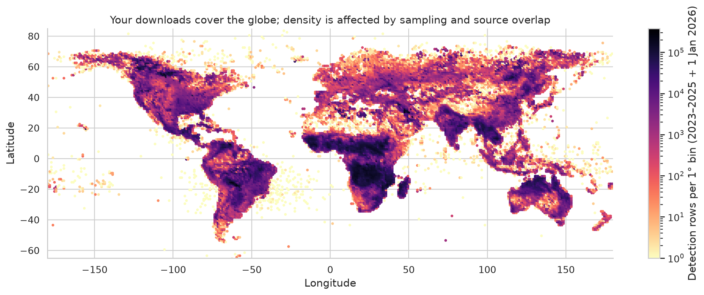
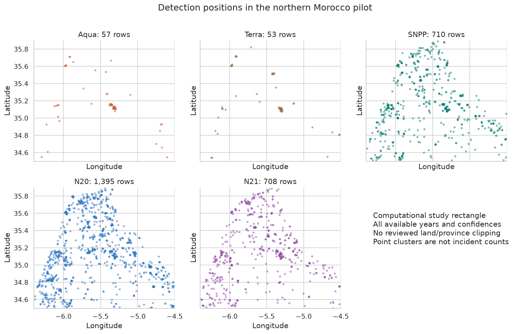
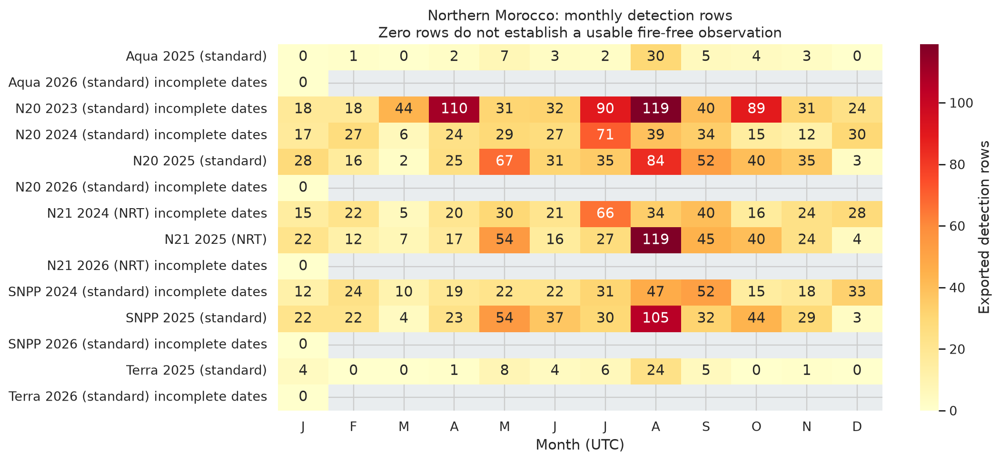
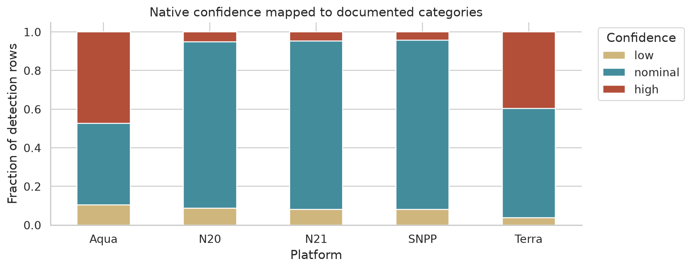
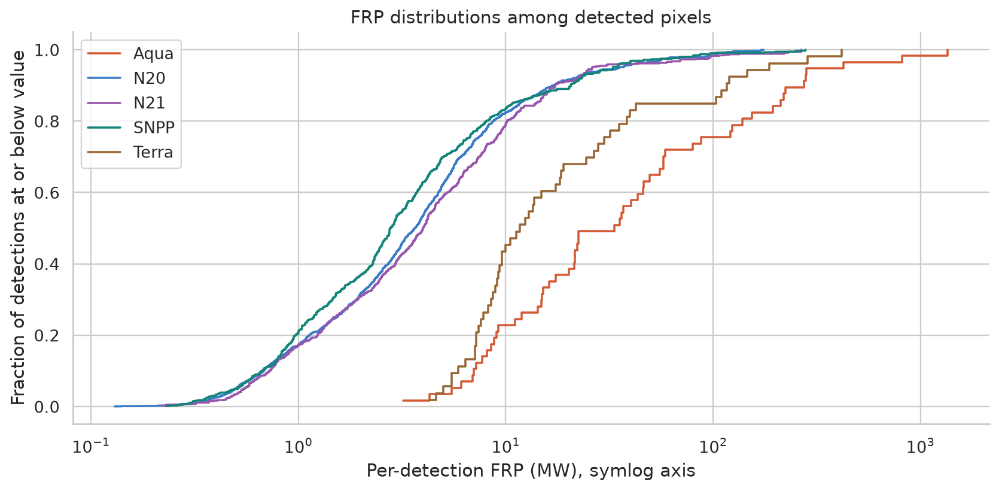
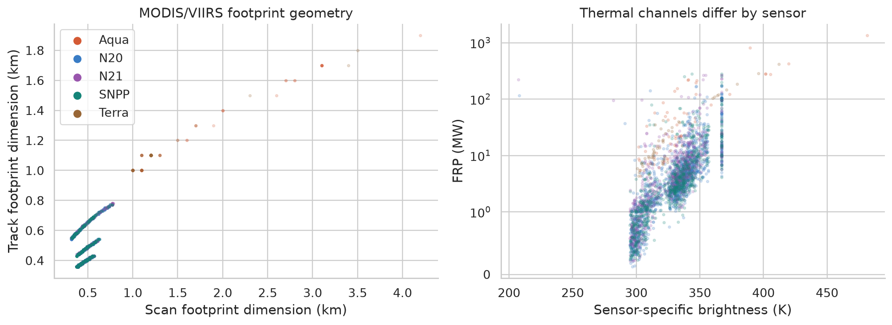
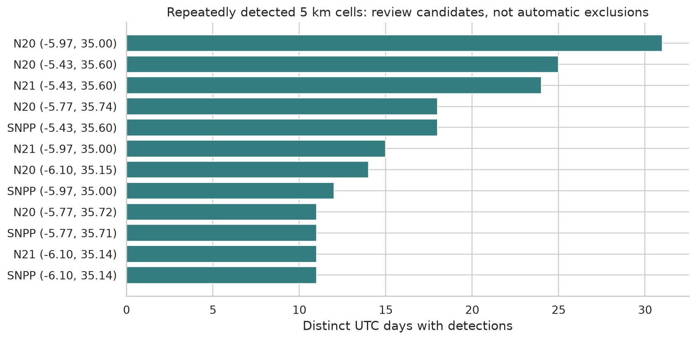
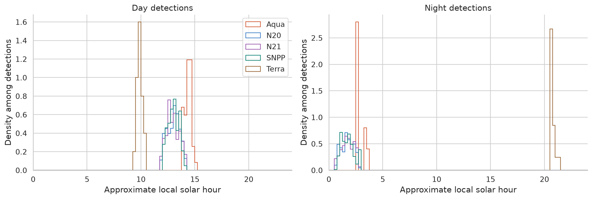
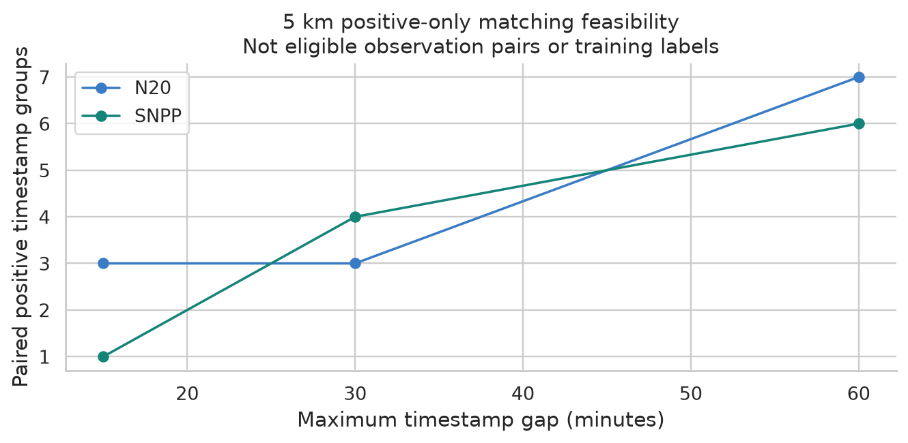
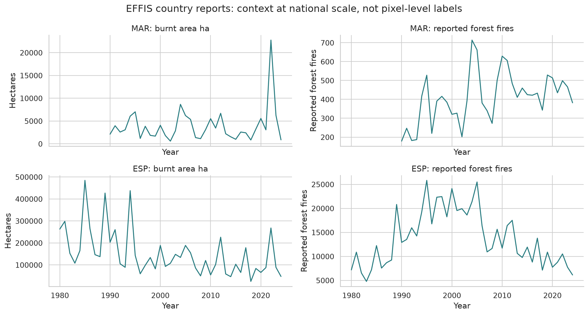

# FIREBRIDGE data exploration

Analysis run: 2026-09-26 19:53 UTC.

## Read this first

The 10 archives contain **148,475,929 detection rows**, using 2.64 GB compressed and 12.05 GB uncompressed. Every CSV row was scanned. The northern Morocco rectangle contains **2,923 valid, exactly deduplicated detections**. Global summaries use all records; global quantiles use a reproducible uniform sample of at most 20,000 rows per archive. Regional quantiles use all regional detections.

**These are hotspot detections, not a table of distinct fires.** Their absence does not prove that a satellite had a clear usable view. Full fire masks plus geolocation are the critical remaining input for the harmonization experiment.

Start with the inventory, then the Morocco figures, then the missing-data checklist. The executed notebook `notebooks/FIREBRIDGE_EDA.ipynb` lets you inspect and change the analysis without rereading the global files.

## Measured findings from this run

- **148,475,929 raw rows** scanned across ten archives; **2,923** valid, exactly deduplicated pilot rows.
- **Annual exports overlap calendar boundaries.** Use the recorded acquisition year, not a guessed filename year. Regional deduplication removed 16 repeated full rows from the union of study rectangles.
- **Landsat contributes zero rows** in the pilot and southern-Spain rectangles.
- **Data gaps block the planned experiment.** The substantive Aqua record supplied here is 2025; the blueprint's earlier reference years and full observation masks are missing.
- **0 nonzero global missing/format-check results** and **0 categorical-domain exceptions** were found. The detailed tables remain authoritative; missing whole columns are reported separately as schema differences.
- **SNPP → Aqua, 5 km / 30 minutes:** 4 matched both-positive timestamp groups (not eligible observation pairs).
- **N20 → Aqua, 5 km / 30 minutes:** 3 matched both-positive timestamp groups (not eligible observation pairs).

Pilot counts by actual UTC year:

| satellite   |   2023 |   2024 |   2025 |
|:------------|-------:|-------:|-------:|
| Aqua        |      0 |      0 |     57 |
| N20         |    646 |    331 |    418 |
| N21         |      0 |    321 |    387 |
| SNPP        |      0 |    305 |    405 |
| Terra       |      0 |      0 |     53 |

Retaining nominal/high confidence gives:

| satellite   |   size |   sum |   retained_percent |
|:------------|-------:|------:|-------------------:|
| Aqua        |     57 |    51 |               89.5 |
| N20         |   1395 |  1272 |               91.2 |
| N21         |    708 |   651 |               91.9 |
| SNPP        |    710 |   652 |               91.8 |
| Terra       |     53 |    51 |               96.2 |

**The reference sample is small:** only 57 Aqua detections on 27 UTC dates are supplied inside the pilot for 2025. The 5 km / 30 minute check finds only four S-NPP/Aqua both-positive timestamp matches. This is insufficient evidence for the proposed model evaluation; broaden continuous time or geography after acquiring masks, and count independent episodes before training. It does not establish how many valid paired negative opportunities exist.

These are detection sample sizes, not counts of independent episodes. Days/cells/passes of one episode remain statistically dependent.

## 1. What you downloaded

| archive                  | platforms   | stream   | first_date   | last_date   |     rows |   pilot_rows |
|:-------------------------|:------------|:---------|:-------------|:------------|---------:|-------------:|
| DL_FIRE_J1V-C2_42006.zip | N20         | standard | 2023-01-01   | 2024-01-01  | 21424849 |          646 |
| DL_FIRE_J1V-C2_42011.zip | N20         | standard | 2024-01-01   | 2025-01-01  | 22663860 |          332 |
| DL_FIRE_J1V-C2_42016.zip | N20         | standard | 2025-01-01   | 2026-01-01  | 18503973 |          418 |
| DL_FIRE_J2V-C2_42012.zip | N21         | NRT      | 2024-01-01   | 2025-01-01  | 21564042 |          322 |
| DL_FIRE_J2V-C2_42017.zip | N21         | NRT      | 2025-01-01   | 2026-01-01  | 17701888 |          387 |
| DL_FIRE_LS_42010.zip     | L9,L8       | NRT      | 2024-01-01   | 2025-01-01  |  1581063 |            0 |
| DL_FIRE_LS_42015.zip     | L9,L8       | NRT      | 2025-01-01   | 2026-01-01  |  1654208 |            0 |
| DL_FIRE_M-C61_42014.zip  | Aqua,Terra  | standard | 2025-01-01   | 2026-01-01  |  3715075 |          110 |
| DL_FIRE_SV-C2_42013.zip  | SNPP        | standard | 2024-01-01   | 2025-01-01  | 21122764 |          305 |
| DL_FIRE_SV-C2_42018.zip  | SNPP        | standard | 2025-01-01   | 2026-01-01  | 18544207 |          405 |

- MODIS contains Aqua and Terra; keep their distinct observation times separate.
- The S-NPP archive writes `instrument=SNPP`. The native value is preserved; the derived sensor family is VIIRS.
- NOAA-21 files are NRT; do not treat their rows as interchangeable with standard archive rows.
- Landsat is a separate source with different field definitions and geographic availability. Its pilot row count above determines its relevance here.
- An already extracted Landsat CSV is inventoried but excluded from ingestion; its filename, size and CRC are compared with the ZIP member (`extracted_copies.json`).
- These files do not supply the blueprint's 2020–2022 training/development years. Aqua's substantive supplied year is 2025; trailing boundary-day records, if present, are shown separately. The originally proposed split is therefore unavailable. Any future 2024 holdout must be reserved again before outcome-driven model work; this EDA is not a frozen evaluation.

## 2. Geography and sampling



The pilot bounds are west −6.4°, south 34.5°, east −4.5°, north 35.9°. They describe a rectangle, not Chefchaouen or Larache administrative boundaries. Land and water have not been polygon-clipped. A broader Morocco context rectangle and a southern-Spain rectangle were extracted for schema and coverage inspection; neither is a national statistic. Southern Spain has not been used for model fitting or performance tuning.



## 3. What the observations look like in Morocco

| satellite   | stream   |   year |   rows |   retained |   days_with_detections |   median_frp_MW |   max_frp_MW |   median_solar_hour |
|:------------|:---------|-------:|-------:|-----------:|-----------------------:|----------------:|-------------:|--------------------:|
| Aqua        | standard |   2025 |     57 |         51 |                     27 |           33.3  |     1.35e+03 |                14.4 |
| N20         | standard |   2023 |    646 |        591 |                    182 |            4.38 |   170        |                12.4 |
| N20         | standard |   2024 |    331 |        305 |                    158 |            2.49 |    56.5      |                12.2 |
| N20         | standard |   2025 |    418 |        376 |                    156 |            3.35 |   175        |                12.3 |
| N21         | NRT      |   2024 |    321 |        303 |                    151 |            3.74 |   112        |                12.2 |
| N21         | NRT      |   2025 |    387 |        348 |                    153 |            4.15 |   266        |                12.2 |
| SNPP        | standard |   2024 |    305 |        288 |                    135 |            2.67 |    86.1      |                12.4 |
| SNPP        | standard |   2025 |    405 |        364 |                    149 |            2.93 |   279        |                12.3 |
| Terra       | standard |   2025 |     53 |         51 |                     22 |           11.7  |   418        |                20.7 |



Cells report exactly deduplicated regional detection rows, including all native confidence classes. Gray/blank cells have no exported global rows for that platform/month. Years with fewer than the expected number of dates with global export rows are labeled incomplete dates; this includes internal gaps and boundary-only years. Some annual files include the next January 1: dates, not filenames, define year membership. A displayed zero means **no rows in this export**, with observation eligibility unknown. The count differences combine actual burning with sensor sensitivity, footprint, timing, processing, and missing observations. They cannot be interpreted as changes in incident numbers or burned hectares.

Busiest dates in the supplied files (all platforms pooled solely to find examples):

| acq_date   |   detection_rows |
|:-----------|-----------------:|
| 2025-08-13 |              128 |
| 2025-08-12 |               59 |
| 2025-05-27 |               58 |
| 2024-07-24 |               52 |
| 2023-10-17 |               45 |
| 2025-08-22 |               44 |
| 2023-07-27 |               38 |
| 2025-08-21 |               35 |
| 2025-05-28 |               31 |
| 2023-04-07 |               31 |

These are exploration candidates. Multiple satellites and adjacent pixels can repeatedly detect one episode. Do not use this ranking as an event catalog or select only these dates for training.

## 4. Quality, duplicates and unusual values

All ZIP CSV members passed full-read CRC verification: **True**. The broad regional subset had **16 exact excess rows**, removed only from derived tables; raw archives are preserved. Global full-row hashing found **304 excess equal hashes**. An independent raw-line comparison confirmed 304 exact duplicates in the 2024 Landsat file (`independent_validation.json`). This is a duplicate screen, not a mathematically collision-free identity proof. Global profile counts remain raw. Cross-file deduplication is exact for regional rows; global cross-file row equality is not exhaustively checked.

See `tables/quality_checks.csv` for missing fields, invalid coordinates, malformed dates/times and nonfinite numeric values. `global_numeric_profile.csv` contains exact extrema/means and explicitly sampled quantiles. `same_detection_key_review.csv` flags distinct records sharing platform, stream, time and location; they are retained for review. A missing column is a schema limitation rather than a zero-valued measurement.



Confidence filtering retains MODIS values ≥30 (nominal/high; high begins at 80) and VIIRS `n`/`h`. Raw rows remain available. These categories indicate detection quality, not comparable calibrated probabilities. No automatic outlier deletion is applied: large FRP may be a real detection, and a VIIRS brightness pile-up can reflect channel saturation. Review the guide before interpreting sentinel values or censoring.



FRP is instantaneous radiative **power in MW**, not energy, burned area, or intensity per unit area. ECDFs compare distributions conditional on detections. They are not sensor calibration curves.



MODIS brightness uses channels 21/22 and 31; VIIRS fields correspond to I4 and I5 even when these exports use generic column labels `brightness` / `bright_t31`. Landsat scan/track are LOS pixel positions and must not enter these kilometer-footprint charts. Brightness temperatures describe the pixel signal, not the literal flame temperature.

Type flags in the pilot:

| satellite   | stream   |   type |   rows |
|:------------|:---------|-------:|-------:|
| Aqua        | standard |      0 |     55 |
| Aqua        | standard |      2 |      2 |
| N20         | standard |      0 |   1379 |
| N20         | standard |      2 |     12 |
| N20         | standard |      3 |      4 |
| N21         | NRT      |    nan |    708 |
| SNPP        | standard |      0 |    710 |
| Terra       | standard |      0 |     49 |
| Terra       | standard |      2 |      4 |

For standard files, type 0 is presumed vegetation fire, 1 volcano, 2 other static land source, 3 offshore. Missing type (especially NRT) is unknown. A vegetation label does not distinguish agricultural burning from wildfire. No type is silently discarded in this EDA.



Repeated detection in one 5 km cell is a review flag, not proof of a factory or false detection. `pilot_recurrence.csv` supports inspection; multiple distinct fires and repeated agricultural burns can occur in one cell.

## 5. Timing and matching feasibility



UTC timestamps are formed with zero-padded HHMM. Approximate local solar hour is UTC hour + longitude/15 modulo 24; it is not Casablanca civil time. These histograms represent **detected** pixels only, not complete orbital coverage. Actual timestamp distributions must replace assumptions of fixed afternoon overpass times.



|   grid_km |   tolerance_min | source   |   pairs |   source_positive_times |   aqua_positive_times |   median_gap_min |
|----------:|----------------:|:---------|--------:|------------------------:|----------------------:|-----------------:|
|         5 |              15 | SNPP     |       1 |                     118 |                    27 |                9 |
|         5 |              15 | N20      |       3 |                     134 |                    27 |                7 |
|         5 |              30 | SNPP     |       4 |                     118 |                    27 |               24 |
|         5 |              30 | N20      |       3 |                     134 |                    27 |                7 |
|         5 |              60 | SNPP     |       6 |                     118 |                    27 |               30 |
|         5 |              60 | N20      |       7 |                     134 |                    27 |               37 |

The diagnostic is restricted to years with supplied Aqua detections (2025 here). It uses daytime nominal/high detections, standard sources, a 5 km EPSG:6933 grid anchored at (0,0), and greedy nearest timestamp matching without reuse within each sensor pair/cell. A timestamp group is not a resolved satellite pass or granule. Only both-positive samples exist here. This cannot estimate recall, false-positive rate, occurrence prevalence, reference-negative labels, or model accuracy. The 2/5/10 km and 15/30/60 minute sensitivity table is in `positive_timestamp_pair_diagnostics.csv`.

## 6. What each dataset adds

| Dataset | What it measures | What FIREBRIDGE needs it for |
|---|---|---|
| FIRMS MODIS/VIIRS points | Locations of detected thermal anomalies | Descriptive calendars and positive detections |
| MYD14 + compatible MYD03 | Aqua fire mask + full-pixel geolocation/geometry | Observable reference positives and negatives |
| VNP14IMG + VNP03IMG | S-NPP fire mask + geolocation | Source coverage and shared usable support |
| VJ114IMG + VJ103IMG | NOAA-20 fire mask + geolocation | Separate successor adapter |
| MOD14 + MOD03 | Terra mask + geolocation | Separate morning-regime analysis; MOD03 is a necessary companion even though omitted from the blueprint table |
| MCD12Q1 | Annual categorical land cover and QC | Forest/cropland/shrubland strata; no ignition cause |
| MCD64A1 | Monthly burned-pixel dates, uncertainty and QA | Timing/spatial corroboration; not independent of MODIS active-fire inputs |
| EFFIS | Country statistics and available burned-area products | External context; check lineage and granularity before evaluation |
| ERA5-Land | Gridded reanalysis weather/soil variables | Optional historical context; not an active-fire mask |
| Local incident reports | Reported events with uncertain time/location | Independent evidence when verified records exist |

Read `DATA_ACCESS.md` for actual download results and remaining authentication requirements. A catalog result is not a downloaded science asset. `download_manifest.json` records successful downloads and failures; the catalog files preserve granule IDs, size estimates and URLs. NASA catalog footprints still require spatial verification against full geolocation.

## Added EFFIS dataset: what it contributes



| country   |   year |   burnt_area_ha |   reported_forest_fires |
|:----------|-------:|----------------:|------------------------:|
| ESP       |   2020 |        65923.00 |                 7745.00 |
| ESP       |   2021 |        87880.00 |                 8780.00 |
| ESP       |   2022 |       267947.00 |                10507.00 |
| ESP       |   2023 |        89068.00 |                 7748.00 |
| ESP       |   2024 |        47711.13 |                 6134.00 |
| MAR       |   2020 |         5569.00 |                  514.00 |
| MAR       |   2021 |         3064.00 |                  435.00 |
| MAR       |   2022 |        22762.00 |                  499.00 |
| MAR       |   2023 |         6246.00 |                  466.00 |
| MAR       |   2024 |          874.00 |                  382.00 |

The real downloaded workbook adds national reported forest-fire counts and burned-area totals. It contains year rows 1980–2024, with country-specific missing values. Morocco values begin later than Spain values. The Morocco 2022 burned-area peak is visible in this source, but these national aggregates cannot validate pixel-scale observations in the northern pilot. Forest-fire reporting definitions also differ from FIRMS, which includes agricultural burning and other thermal anomalies. No regional/national count ratio is interpreted as sensor accuracy. Source: [EFFIS country totals](https://forest-fire.emergency.copernicus.eu/effis/applications/data-and-services/report_2024.xlsx).

## 7. Recommended data decisions

1. Keep all raw files and native sensor fields. Use the small regional Parquet tables for daily work.
2. Use 2025 for the first descriptive Aqua–S-NPP feasibility exercise because those are the supplied overlapping files. Acquire standard 2020–2024 regional points before implementing the blueprint split. Avoid downloading more global CSVs just to work on Morocco.
3. Download and inspect a continuous, predeclared week of paired masks/geolocation including periods with no detected hotspots. Discovery here uses 14–20 July 2025; it is a schema/access smoke test, not a representative training sample or an event-selected success case.
4. Resolve collections and companions using acquisition keys, then compute full-pixel valid/cloud/water/invalid fractions. Follow documented QA definitions; do not guess bit masks.
5. Review a land/AOI polygon, establish the analysis grid, and preserve observations excluded by coverage thresholds with reasons.
6. Freeze temporal/spatial splits before fitting or selecting any harmonization model. EDA alone supplies no measured ML improvement.

## 8. Reproduce and audit

From the project root:

```bash
firebridge_env/bin/python analysis/profile_archives.py
firebridge_env/bin/python analysis/build_eda.py
firebridge_env/bin/python analysis/make_notebook.py
```

The full scan is chunked at 200,000 rows, processes one archive at a time, and caches per-file results keyed by source size/mtime. SHA-256 and ZIP CRC are recorded for each archive. A same-size/same-mtime modified file would require clearing its cache. Raw download timestamps are unknown for the supplied archives; filesystem timestamps are not claimed as retrieval times. The notebook uses precomputed data. `requirements-lock.txt` records package versions.

Integrity assertions reconcile regional raw rows, exact duplicates, quarantined rows, and independent grouped totals. All charts are descriptive. The missing observation denominator prevents computation of the blueprint's H(W) and C(W) metrics.

## Sources and definitions

- [NASA FIRMS archive README](https://firms.modaps.eosdis.nasa.gov/download/Readme.txt) — file naming and stream conventions. Its NOAA-20 availability note conflicts with actual supplied standard files; source files and current catalog inventory take precedence for this inventory.
- [NASA MODIS/VIIRS attribute definitions](https://www.earthdata.nasa.gov/data/tools/firms/active-fire-data-attributes-modis-viirs) — measurement units, confidence, type flags and spectral meaning.
- [MODIS C6/C6.1 fire user guide](https://www.earthdata.nasa.gov/s3fs-public/2023-09/MODIS_C6_C6.1_Fire_User_Guide_1.0.pdf) — product and mask interpretation.
- [VIIRS Collection 2 fire user guide](https://www.earthdata.nasa.gov/s3fs-public/2025-06/VIIRS_C2_AF-375m_User_Guide_1.2.pdf) — VIIRS-specific interpretation.
- [NASA Landsat FAQ](https://forum.earthdata.nasa.gov/viewtopic.php?t=5197) — Landsat coverage, scan/track semantics and detection characteristics.
- [NASA CMR](https://cmr.earthdata.nasa.gov/search/site/docs/search/api.html) — collection/granule discovery; query responses saved locally.
- [EFFIS data/services](https://forest-fire.emergency.copernicus.eu/applications/data-and-services) — country totals and data request routes.
- [ORNL subset service](https://modis.ornl.gov/data/modis_webservice.html) — bounded scientific subsets; service failures are retained.
- [ERA5-Land](https://cds.climate.copernicus.eu/datasets/reanalysis-era5-land?tab=overview) — optional context.

Local analysis follows the supplied `FIREBRIDGE_Blueprint.md` as a proposed research design, not a validated algorithm. No app, predictive model or hackathon submission is produced here.
