# MODIS Terra and Aqua: understanding the data for FIREBRIDGE

**17 January 2024 – 17 January 2025, inclusive · Worldwide · Standard processing**

This report explains exact full-population analysis results and the next project steps. The HTML version contains all charts inline for offline sharing.

[Presentation (PPTX)](MODIS_Terra_Aqua_2024_2025_Presentation.pptx) · [Slides (PDF)](MODIS_Terra_Aqua_2024_2025_Presentation.pdf) · [Speaker notes](PRESENTATION_SPEAKER_NOTES.md) · [Executed notebook](../../notebooks/MODIS_Terra_Aqua_2024_2025.ipynb)

## 1. Start with the dataset

We now have the full worldwide record requested: **4,876,343 MODIS detections** from **17 January 2024 through 17 January 2025**, including both end dates. Terra and Aqua are kept separate throughout the analysis.

The source is the standard, science-quality **MCD14ML Collection 6.1, version 03** product. We downloaded 13 monthly files from the official University of Maryland MODIS Fire Science Team archive and selected the requested dates. The files were read completely and checked; raw originals and their checksums are preserved.

> **The date window.** There are **367 UTC calendar dates** in this window. January 2024 includes only 17–31 January (15 dates); January 2025 includes only 1–17 January (17 dates). Monthly comparisons below account for these partial months.

| Platform | Recorded detections | Share of the selected record |
| --- | --- | --- |
| Terra | 1,528,867 | 31.4% |
| Aqua | 3,347,476 | 68.6% |

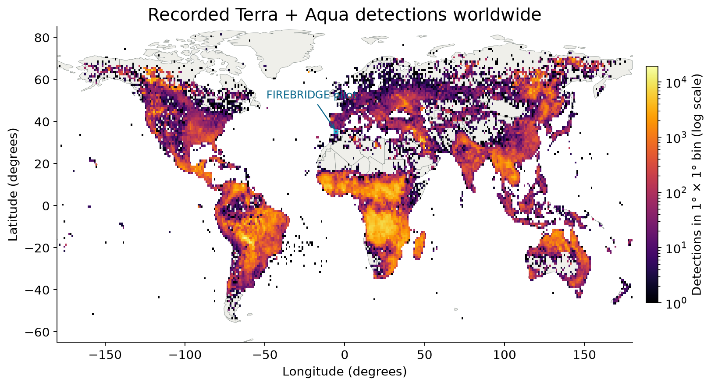

Figure 1. The map combines both platforms in **1° × 1° bins**, with color on a logarithmic scale. Dense areas contain more exported detections. Degree bins have unequal physical areas; this map does not measure risk or burned area.

### Source files, processing and reproducibility

The [input inventory](tables/input_inventory.csv) lists every monthly file, bytes, SHA-256 checksum and rows included/excluded by the date filter. The [download manifest](../../data/external/modis_2024_2025/acquisition_manifest.json) records the provider URLs. These are standard historical products; no near-real-time data were merged into the record.

Read the [full machine-readable summary](summary.json), [validation results](validation.json), [raw-schema guide](../../data/external/modis_2024_2025/README.md), and [scientific interpretation notes](SCIENCE_NOTES.md). All main counts and quantiles use the full selected population. A reproducible sample is used only for visual scatter plots.

## 2. Understand one real observation

On **2024-02-21 at 14:04 UTC**, **Aqua** recorded a thermal anomaly centered at **35.5003°, -5.5547°**. The row reports **5.5 MW FRP**, confidence **58**, and inferred type **0**. This is an actual row from the selected data.

> **What a row means.** Tell the team: **“At this time, this satellite detected a hot pixel at this location.”** One ongoing fire can generate many pixels and many later observations. Several fires can also occur inside one pixel. A hotspot row is not an incident count, an ignition coordinate, or a perimeter.

**The 12 native columns, grouped for readability**

| Field | Question it answers | How to read it |
| --- | --- | --- |
| Date + time | When MODIS measured the pixel | UTC; `0039` means 00:39 |
| Latitude + longitude | Center of the detected pixel | Decimal degrees |
| Satellite | Which observing platform | Terra (`T`) or Aqua (`A`) |
| T21 + T31 | Two thermal brightness temperatures | Kelvin; not flame temperature |
| FRP | Radiative power from that fire pixel | Megawatts (MW); a rate, not energy |
| Confidence | Native detection-quality score | 0–100; not a calibrated wildfire probability |
| Type | Inferred source category | 0 presumed vegetation; 1 volcano; 2 static land; 3 offshore |
| Day/night + sample | Algorithm regime and cross-track pixel index | D / N; zero-based sample 0–1353 |

The nominal MODIS fire-pixel scale is about 1 km directly below the satellite (**nadir**), and grows toward the edge of the strip observed during one pass (the **swath**). That is the observation footprint; a smaller fire may be detectable. The coordinates locate the pixel center, so a map dot should not imply a precise fire boundary.

### Data dictionary and units

The native source names are `YYYYMMDD HHMM sat lat lon T21 T31 sample FRP conf type dn`. The processed table gives them clearer names and adds derived UTC timestamps, inclusion flags, source filenames and source row numbers. Native `sample` is zero-based, 0–1353.

The original monthly product has no explicit `scan` or `track` columns. They are available only in the separate January 2025 FIRMS overlap used for a limited footprint audit. The native guide calls T21 the band-21 brightness-temperature field; FIRMS describes its exported brightness channel as band 21/22. Both are brightness temperatures expressed in Kelvin, not measured flame temperature.

## 3. Compare the two sampling schedules

Aqua recorded **2.19 times** as many detections as Terra in this window. This describes the downloaded observations. It does not establish that Aqua is 2.19 times more accurate or that either satellite sees every fire.

| Platform | Daytime detections | Nighttime detections | Daytime share |
| --- | --- | --- | --- |
| Terra | 914,760 | 614,107 | 59.8% |
| Aqua | 3,107,414 | 240,062 | 92.8% |

Both platforms carry MODIS, but observe places at different times. Fires can grow, cool or stop between observations. Cloud, viewing geometry, background temperature and successful observation opportunities also change. This point dataset cannot determine how much of the difference each cause explains.

> **Decision for FIREBRIDGE.** The blueprint uses **Aqua as the afternoon reference convention** for harmonization with VIIRS. Aqua remains an imperfect observation. Terra provides a separate morning regime and needs its own adapter and evaluation before calibrated integration.

## 4. Check whether the record is usable

The quality audit checks all selected rows, rather than a sample: dates, coordinates, missing values, numeric values, platform labels, native categories, exact duplicates and the January overlap with your existing FIRMS download.

| Audit | Result | Meaning / treatment |
| --- | --- | --- |
| Rows selected from raw files | 4,876,343 | Exact UTC date filter |
| Exact duplicate excess | 0 | Removed from the analysis view; raw files retained |
| Quarantined rows | 0 | Invalid essential fields excluded with a record |
| Negative FRP | 0 | Excluded from FRP summaries; kept as a quality flag |
| Zero FRP | 2,425 | Reported separately; not automatically deleted |
| Dates with any global detection | 367 / 367 | Exported detections somewhere worldwide |

There are **no missing native fields, non-finite numeric values, invalid timestamps/coordinates, invalid platform/category values, invalid sample indices, or nonpositive thermal temperatures** in this selected record.

As an independent check, we compared the new UMD record with your earlier FIRMS CSV for **1–17 January 2025**. **202,406 observations match on every shared native field**; UMD-only rows: **0**; FIRMS-only rows: **0**. The FIRMS file was used for this audit, so its rows are not counted a second time.

> **The main unresolved gap.** A calendar day with exported points somewhere on Earth does not prove a usable observation in a particular cell. A regional zero means **no exported detection**, and cannot yet become a clear-sky “no fire” label.

### Inspect the audit evidence

Open the [complete quality table](tables/quality_checks.csv), [exact duplicates](tables/exact_duplicates.csv), [quarantine](tables/quarantine.csv), and [January overlap audit](january_overlap_audit.json). [Repeated location/time keys](tables/location_time_key_review.csv) are retained for review; nearby observations at different times can legitimately describe the same continuing fire.

Downloaded global dates support inventory checks. Per-cell valid observation support remains unavailable from the point files. Full masks, **quality flags (QA)** and matching geolocation are still needed to distinguish no retained detection from cloud, missing or unsupported observation.

## 5. Follow the year, with the right denominator

The busiest calendar month by total detections is **2024-08**, with **773,697** rows across both platforms. The chart compares detections **per requested calendar day**, so the partial January periods are not mistaken for complete months.

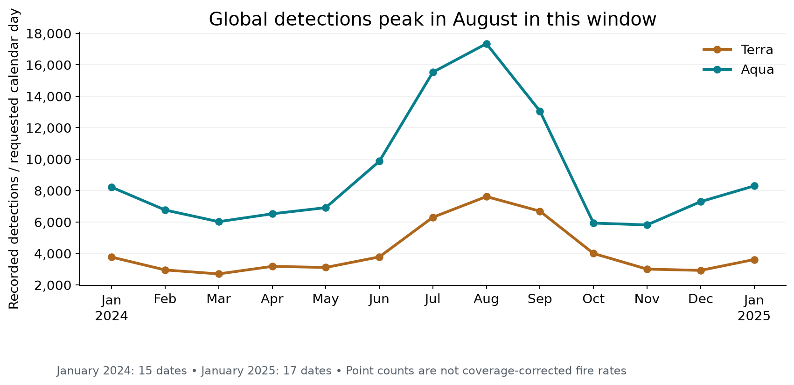

Figure 2. January 2024 represents **15 dates**, January 2025 **17 dates**. Dividing by calendar dates fixes that unequal duration; it does **not** correct for cloud, missing observations or unequal usable land coverage.

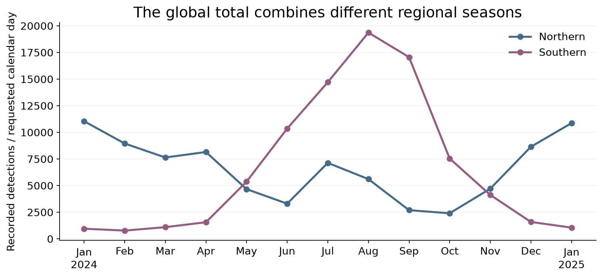

Figure 3. Global counts combine regions with different fire seasons, land uses and observation conditions. Separating hemispheres is a first step toward regional interpretation.

Use these patterns to choose demonstration periods and investigate where activity concentrates. Describe them as **recorded detection patterns**. Climate explanations, causes of burning and coverage-corrected changes require additional evidence.

> **One year is a starting record.** This window contains **one annual cycle**. It can describe this year, but cannot establish a long-term climatology, a trend, or whether a season was unusually active. Those questions need several comparable years and observation support.

### Exact seasonal tables

The [monthly table](tables/monthly.csv) includes the date denominator, partial-month flag, all-detection count, baseline count and vegetation-focused count. The [daily table](tables/daily.csv) preserves every date and platform with `valid_observation_coverage = unknown_from_points`. The [hemisphere table](tables/hemisphere_monthly.csv) separates broad seasonal regimes.

## 6. Read confidence and radiative power

Confidence describes the algorithm's detection-quality score. FRP describes radiative power at the observed time. They help filter and characterize observations, but answer different questions.

| View | Rows kept | Share of valid detections |
| --- | --- | --- |
| All valid detections | 4,876,343 | 100% |
| Nominal / high: confidence ≥30 | 4,629,440 | 94.9% |
| Vegetation-focused: type 0 + confidence ≥30 | 4,433,643 | 90.9% |
| High confidence only: confidence ≥80, all types | 1,432,043 | 29.4% |

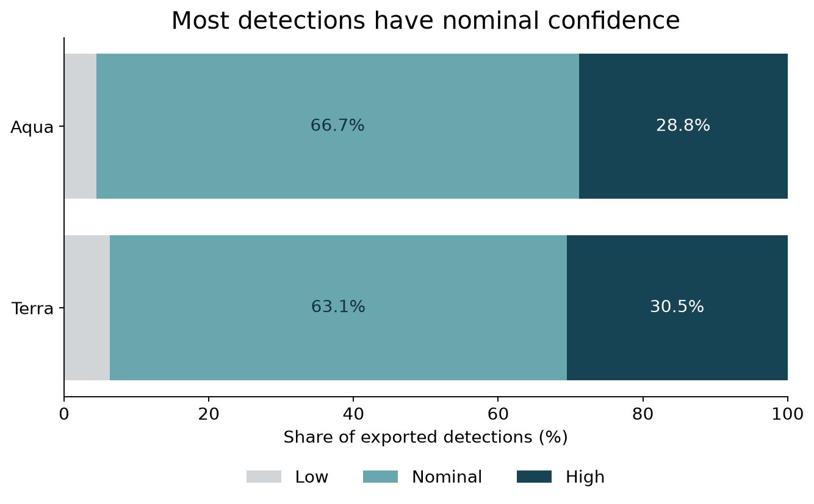

Figure 4. Confidence classes are **low 0–29**, **nominal 30–79**, **high 80–100**. All native classes remain in the EDA record.

| Inferred type | Terra | Aqua |
| --- | --- | --- |
| 0: Presumed vegetation fire | 1,411,637 | 3,252,331 |
| 1: Active volcano | 4,221 | 3,609 |
| 2: Other static land source | 103,186 | 82,900 |
| 3: Offshore | 9,823 | 8,636 |

Type 0 does not distinguish wildfire from agricultural or prescribed burning. Keep the inferred categories available for review instead of calling every row a wildfire.

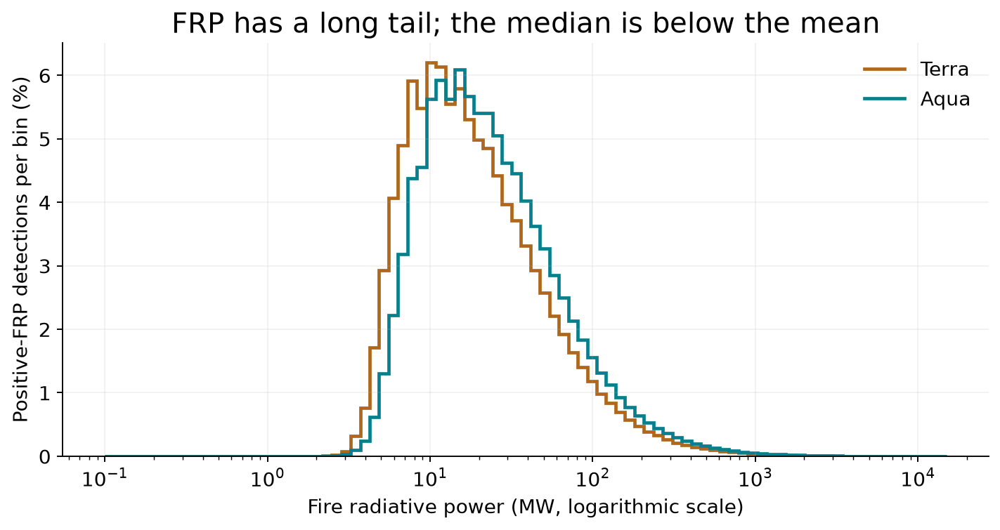

Figure 5. This histogram shows **positive FRP** on a logarithmic scale. All **2,425 zero-FRP rows** remain in the record and the nonnegative-FRP summaries below. Negative FRP rows in this selected window: **0**. Very high observations deserve investigation rather than automatic deletion.

| Platform | Median FRP | 95th percentile | Maximum |
| --- | --- | --- | --- |
| Terra | 16.3 MW | 115.7 MW | 12,423.7 MW |
| Aqua | 20.6 MW | 143.0 MW | 13,490.3 MW |

> **How to explain the limits.** Confidence 80 is **not an 80% probability of a wildfire**. FRP in MW is **not burned hectares or total energy**. Summing FRP over different passes or days does not produce energy without defensible time integration and gap treatment.

The FRP means are **36.6 MW for Terra** and **45.0 MW for Aqua**, above their medians. A relatively small high-power tail pulls up the average. Use medians and percentiles alongside the mean when describing a typical recorded pixel.

### Sensitivity and thermal relationships

The proposed baseline keeps nominal/high MODIS detections, confidence ≥30, while preserving every raw class. A vegetation candidate layer also requires type 0. Compare [thresholds 0, 30, 50, 80 and 90](tables/confidence_sensitivity.csv) before freezing a project rule. A stricter rule changes the observed population; it does not turn it into ground truth.

The [exact quantiles](tables/exact_quantiles.csv) and [largest FRP rows](tables/frp_extremes.csv) expose the tails. [Spearman correlations](tables/type0_spearman.csv) are computed within platform and day/night for type-0 observations. Thermal contrast is a sensor-specific feature, rather than a universal fire-severity scale.

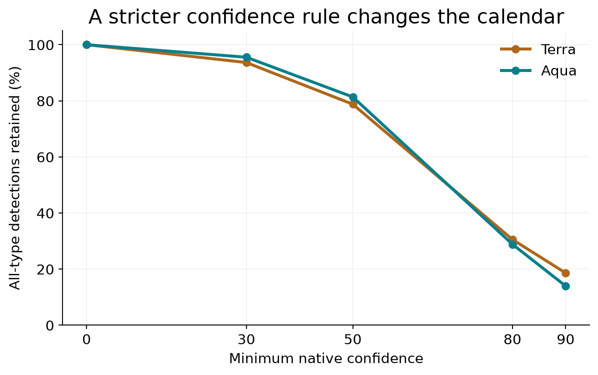

Figure 6. The threshold changes the observed population. The all-type ≥30 baseline and type-0 candidate rule are proposed project choices, rather than verification of wildfire.

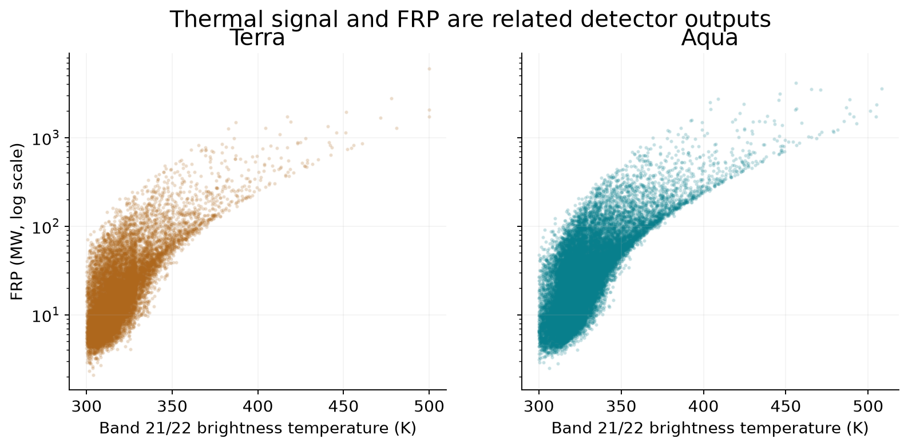

Figure 7. This **40,000-row sample** is for visual scatter only (seed 20241017). Exact summary and correlation tables use the full appropriate population. The relationship between two detector outputs is not causal evidence or a measurement of flame temperature.

## 7. Use the acquisition times actually observed

Terra and Aqua have drifted away from their historical nominal crossing times. For this year, use the recorded timestamps and inspect their distribution instead of assigning every observation the old textbook time.

| Platform | Daytime median solar time | Nighttime median solar time |
| --- | --- | --- |
| Terra | 09:55 | 21:39 |
| Aqua | 14:12 | 02:17 |

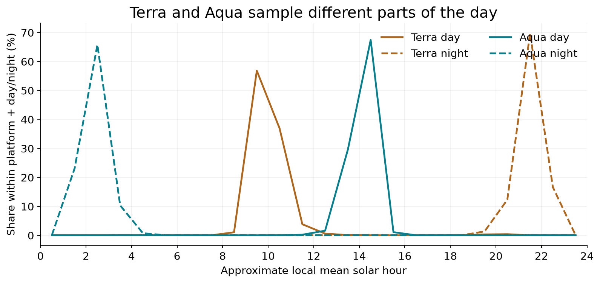

Figure 8. Approximate mean solar time is **UTC + longitude / 15 hours**, wrapped over 24 hours; the local date is also retained. This is not civil clock time, and no equation-of-time correction is applied. These are times of detected hotspots, rather than the complete satellite observation schedule.

**Pixel dimensions: January 1–17, 2025 FIRMS overlap only**

| Platform | Median scan / median track | 95th-percentile scan / track |
| --- | --- | --- |
| Aqua | 1.20 / 1.10 km | 3.10 / 1.70 km |
| Terra | 1.20 / 1.10 km | 3.30 / 1.70 km |

The complete monthly record contains the cross-track sample index, but not explicit pixel width/height fields. The footprint table above comes only from the independently checked FIRMS January overlap. It demonstrates varying observation geometry; it is not a full-year geometry summary. `scan × track` approximates pixel footprint, not land actually burning.

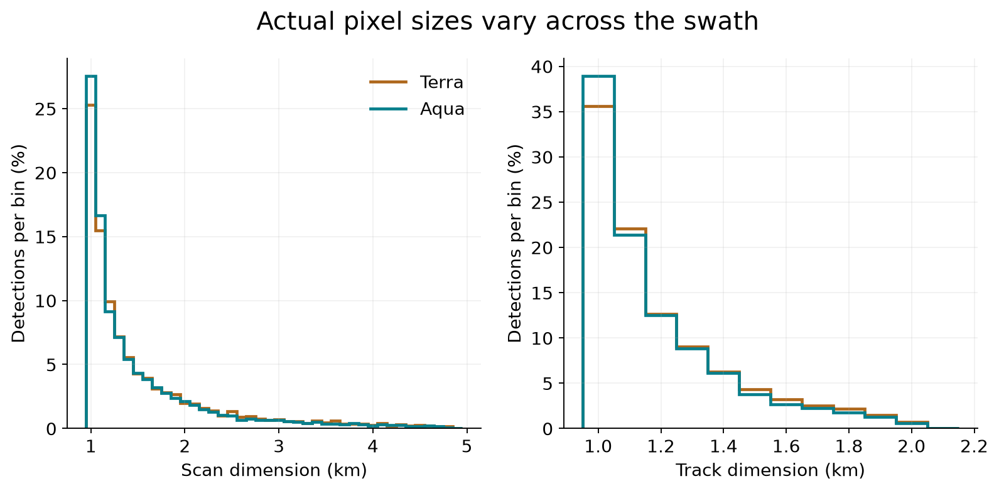

Figure 9. The **202,406-row January overlap** shows FIRMS pixel dimensions. Keep this limited date scope visible. Full-year native MCD14ML instead provides the sample index.

### Timing and geometry evidence

Read [solar-hour bins](tables/solar_hour_bins.csv), [monthly solar timing](tables/monthly_solar_timing.csv), and the limited [January footprint summary](tables/january_footprint_summary.csv). Historical nominal daytime crossings were around 10:30 Terra and 13:30 Aqua; NASA's 2024 mission material documents drift, so those nominal times should not be hard-coded for this analysis.

## 8. Zoom into the northern Morocco study window

Within the blueprint's northern Morocco rectangle, the selected year contains **57 detections**, of which **49** satisfy the vegetation-focused rule. This is the project's first local study window.

> **Keep the geography precise.** Bounds: west **−6.4°**, south **34.5°**, east **−4.5°**, north **35.9°**. This rectangle is a study window. It is not the boundary of Morocco, a province, or a national estimate. Review a land mask and an **area of interest (AOI)** polygon before regional rates.

| Platform | All detections | Type 0 + confidence ≥30 | Dates with any exported detection |
| --- | --- | --- | --- |
| Terra | 22 | 16 | 15 / 367 |
| Aqua | 35 | 33 | 18 / 367 |

This is a small local candidate sample. Before expecting a reliable local model, count independent eligible observation blocks and fire episodes. Broaden training years or the reviewed training area if the pilot supplies too few independent examples.

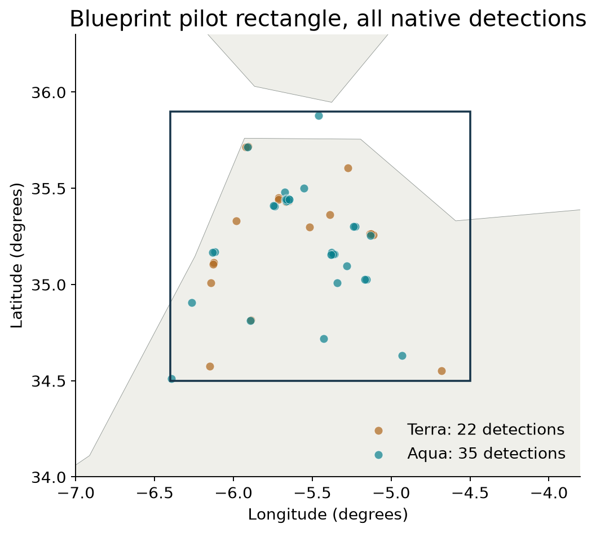

Figure 10. The map helps review spatial groups and recurring locations. A concentration is a candidate for investigation; its cause and incident identity are not supplied by these points.

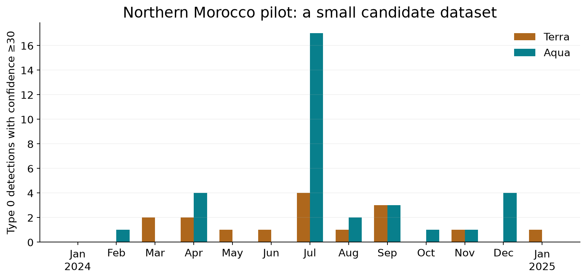

Figure 11. This local calendar contains the **49 vegetation-focused candidates**. Monthly endpoint totals have unequal durations because January periods are partial. A zero cannot yet say whether the satellite observed usable land with no retained hotspot.

### Grid sensitivity and recurrence

We explored the blueprint's proposed equal-area pilot grid at **2, 5 and 10 km**, retaining the vegetation/confidence rule. Counts of occupied cells and positive cell-days change with grid size. These are positive-support summaries, not activity rates: eligible negative observations and usable-area denominators are still missing.

Open [grid sensitivity](tables/regional_grid_sensitivity.csv), [5 km recurrence](tables/pilot_5km_recurrence.csv), [monthly pilot observations](tables/pilot_monthly.csv), and [every pilot detection](tables/pilot_detections.csv). Recurrence may reflect a continuing fire, repeated vegetation burning or a static-source classification issue; investigate before assigning an incident label.

The broader Morocco-context and southern-Spain outputs are also rectangles, explicitly named as such in the [regional summary](tables/regional_summary.csv). They provide nearby context without claiming national administrative totals.

## 9. Turn this EDA into FIREBRIDGE inputs

This record can already support a transparent map, a detection calendar, sensor comparisons and selection of demonstration periods. The next scientific step is to build valid observation opportunities for the blueprint's Aqua-equivalent response.

| What we have | Use in FIREBRIDGE | What still needs evidence |
| --- | --- | --- |
| Native detections + provenance | Traceable map and observed-hotspot calendar | A hotspot calendar is not a complete fire-occurrence calendar |
| Platform, UTC and solar timing | Separate morning/night/afternoon regimes | Full per-pass observation schedule and shared support |
| Confidence, type, temperatures, FRP | Documented inclusion rules and source features | Threshold sensitivity and predictor availability at inference |
| Pilot points and candidate grid | Choose cell size and inspect local examples | Land polygon, cloud/invalid masks and usable area |
| Aqua afternoon observations | Defined reference response for VIIRS harmonization | Eligible paired positives and negatives, blocked evaluation |
| Terra morning observations | Separate historical observation layer | Separate Terra adapter and evaluation |

> **The calendar contract.** Keep three states in the product: **retained hotspot**, **usable observation with no retained hotspot**, and **unsupported/missing observation**. Point files establish the first state. Full masks and geolocation are required to distinguish the other two.

The initial dataset layer should keep raw observations and derived flags together: source asset/row, platform, UTC timestamp, coordinates, native confidence/type/FRP/thermal fields, approximate solar date/time, inclusion rule and any exclusion reason. Preserve the difference between observed evidence and a later model prediction.

## 10. What the team should do next

1. **Freeze a reproducible starting record.** Use the downloaded full-year standard files and the processed detections. Keep all native classes; publish the ≥30 baseline and type-0 candidate rule with their sensitivity results. The requested point-data acquisition and EDA are now complete.
2. **Choose one reviewed pilot AOI and demonstration window.** Inspect the local map, calendar and recurring locations. Agree on a land polygon and an equal-area grid; test 2/5/10 km before freezing the proposed 5 km pilot choice.
3. **Download a bounded continuous swath sample.** Acquire Aqua `MYD14 + MYD03`, Terra `MOD14 + MOD03`, and the relevant VIIRS fire-mask/geolocation companions. Resolve compatible collections and acquisition keys, decode full masks and quality flags (QA), and geolocate non-fire pixels too. These science swaths remain pending; only the standard point record is complete.
4. **Construct eligible cell/pass opportunities.** Record usable land, cloud and invalid fractions. A candidate Aqua–VIIRS pair starts with ≤30 minutes and ≥80% shared usable-land support, then tests alternative tolerances. Match without selecting on detected fire. Negatives require a usable reference observation with no retained hotspot.
5. **Evaluate a small afternoon baseline before a complex model.** Compare common-grid detection and logistic regression using source-only count/FRP/geometry/coverage features. Freeze spatial and temporal blocks; keep 2024 for final temporal evaluation as proposed in the blueprint, and acquire earlier independent training/development seasons. Separate calibration and test data. Aqua is the reference convention, not ground truth.
6. **Build the team demo around evidence.** Show native observations, usable support, model output and held-out errors as distinct layers. Add Terra through a separate adapter once evaluated. Burned-area/perimeter/incident records can corroborate patterns later; no accuracy, hectares-burned or coverage-corrected trend claim follows from this EDA alone.

### A one-minute explanation for the team

“We downloaded the standard worldwide MODIS record for the exact year: 4,876,343 detected hot pixels from Terra and Aqua. Every row tells us what a satellite detected at a particular time, so repeated rows are not repeated fire incidents. Aqua and Terra sample different times, which is why we compare them separately. The EDA shows where and when detections concentrate and how confidence, power and geometry behave. We can already build a map and observed-hotspot calendar. To build FIREBRIDGE's comparable calendar and test a harmonization model, our next step is full masks and geolocation, so we know when a cell was actually observed and can create valid positive and negative examples.”

### Primary references and project evidence

Project: [FIREBRIDGE blueprint](../../FIREBRIDGE_Blueprint.md). Scientific interpretation: [source notes](SCIENCE_NOTES.md). Acquisition: [raw-data README](../../data/external/modis_2024_2025/README.md). Analysis: [summary](summary.json) and [validation](validation.json).

[MODIS Collection 6/C6.1 user guide](https://www.earthdata.nasa.gov/s3fs-public/2023-09/MODIS_C6_C6.1_Fire_User_Guide_1.0.pdf) supports the native schema, confidence/type classes, standard product access and point-only limitations. [NASA FIRMS archive](https://firms.modaps.eosdis.nasa.gov/download/) explains the standard historical data route.

[NASA MODIS fire FAQ](https://forum.earthdata.nasa.gov/viewtopic.php?t=5191) and [FRP/confidence explanation](https://forum.earthdata.nasa.gov/viewtopic.php?t=4541) support pixel and signal interpretation. [NASA 2024 orbital-drift material](https://ntrs.nasa.gov/api/citations/20250000522/downloads/AGU24_Terra_25years_MODIS_geometry_poster_GLin.pdf) supports the timing caveat. Reference details were checked on 10 October 2026 in the source notes.
